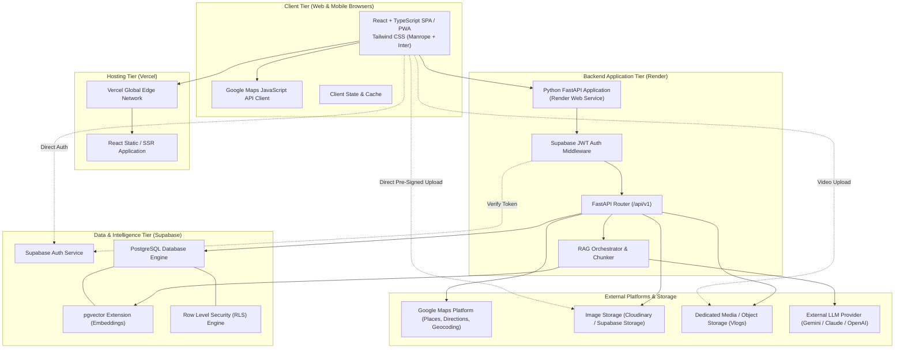
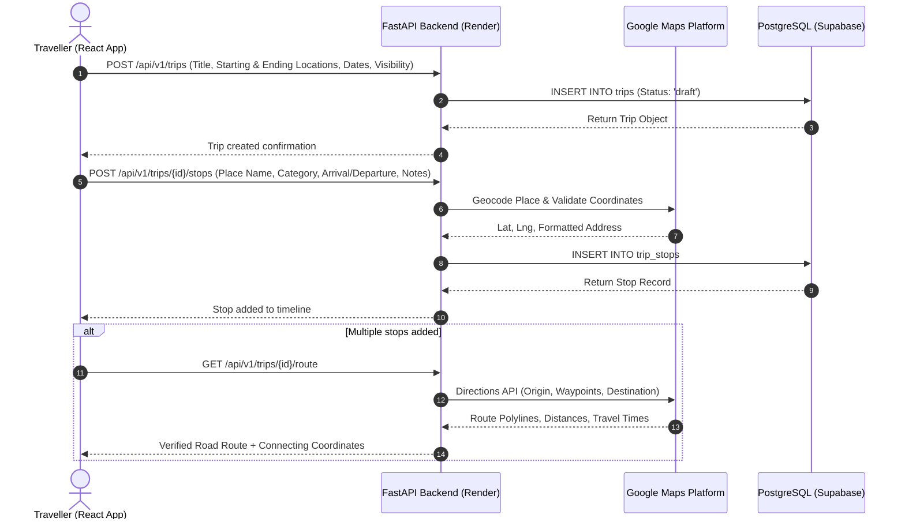
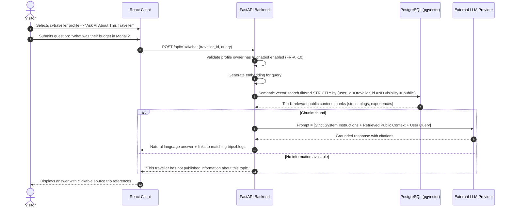

# System Architecture & Technical Specifications
## Project: MICHI (道) — The Adventure Explorer Travel Social Platform

**Version:** 1.0  
**Status:** Approved Architecture (Aligned with PRD v1.0)  
**Date:** November 2026  
**Document Owner:** Engineering & Architecture Team  

---

## 1. Architectural Overview & System Principles

MICHI is a journey-centric travel social networking platform built using a modern decoupled client-server architecture:
- **Frontend Tier**: **React + TypeScript** with **Tailwind CSS**, hosted on **Vercel**. Designed with **Google Stitch** following the Adventure Explorer identity.
- **Backend Tier**: **Python FastAPI**, hosted on **Render**, providing high-performance asynchronous REST endpoints, RAG pipeline orchestration, and background worker coordination.
- **Data & Auth Tier**: Managed **PostgreSQL with pgvector** and **Supabase Auth**, hosted on **Supabase**.
- **Geographic Services**: **Google Maps Platform** (Maps JavaScript API, Places API, Directions API, and Geocoding API).
- **Media Tier**: **Cloudinary / Supabase Storage** for responsive photographs, and **dedicated media/object storage** for video streaming and trip vlogs.
- **Testing**: **TestSprite** for automated frontend UI flows and **Pytest** for backend API and integration tests.

---

## 2. High-Level Architecture Diagram

---

## 3. Component Breakdown

### 3.1 Frontend (React + TypeScript)
- **Framework & Language**: React 19, TypeScript, Vite / Next.js SPA build.
- **Styling**: Tailwind CSS with custom theme configuration matching the approved Adventure Explorer palette:
  - Adventure Orange (`#FF7138`), Forest Green (`#246B4A`), Sky Blue (`#45B8E8`), Sunshine Yellow (`#FFD166`).
  - Light Background (`#F7F8F3`) & Surface (`#FFFFFF`); Dark Background (`#141A18`) & Surface (`#202925`).
- **Typography**: Manrope for all headings; Inter for all body text.
- **Mapping**: Google Maps JavaScript API with custom map styles matching Light and Dark themes, rendering route polylines and stop markers.
- **Testing**: TestSprite for end-to-end UI user journeys.

### 3.2 Backend (Python FastAPI)
- **Framework**: FastAPI (Python 3.11+) running on Uvicorn/Gunicorn.
- **Identity & Resource Server Model**: Supabase Auth serves as the single source of truth for identity. The backend never stores user passwords or mints separate authentication credentials; instead, FastAPI acts as an authoritative resource server validating incoming Supabase Bearer JWTs via the project JWKS endpoint (`SUPABASE_JWKS_URL`).
- **Structure**:
  - `routers/`: Modular route handlers (`auth`, `profiles`, `trips`, `stops`, `experiences`, `blogs`, `media`, `social`, `explore`, `ai_chat`, `notifications`).
  - `services/`: Business logic for profiles, trip management, Google Maps routing calls, EXIF parsing, and notifications.
  - `rag/`: Document chunking, vector embedding generation, and profile-filtered vector search.
  - `models/`: SQLAlchemy models mapping to PostgreSQL tables (`public.profiles`, `public.trips`, etc.).
- **Testing**: Pytest with `httpx` async test client and local test database.

### 3.3 Database (PostgreSQL + pgvector via Supabase)
- **Primary Relational Store**: PostgreSQL with UUID primary keys.
- **Vector Search Engine**: `pgvector` extension for storing and indexing high-dimensional text embeddings of public trip stops, blogs, and experiences.
- **Security**: PostgreSQL Row Level Security (RLS) guaranteeing that private trips, private blogs, and draft content cannot be retrieved by unauthorized callers or AI search queries.

### 3.4 Media & Storage Architecture
- **Photographs**: Images are validated on upload, converted to WebP formats, and stored in Cloudinary or Supabase Storage.
- **Videos & Vlogs**: Scaled independently from the main FastAPI server; uploaded via pre-signed upload URLs to dedicated object storage, with metadata recorded in the `media_assets` table.
- **Rule**: Actual image and video binary files are **never** stored directly in PostgreSQL.

---

## 4. Key Data Flows

### 4.1 Trip Creation and Stop Routing Flow

### 4.2 AI Traveller Profile Chatbot (RAG Flow)

---

## 5. Architectural Decision Status (ADR)

| Topic | Status | Selected Technology | Rationale |
| :--- | :---: | :--- | :--- |
| **Frontend Framework** | **Approved** | React + TypeScript (Vercel) | Standard robust SPA architecture, rapid UI component iteration with Stitch. |
| **Backend Framework** | **Approved** | Python FastAPI (Render) | High-performance async Python, optimal for AI/RAG integrations and Pytest. |
| **Mapping Engine** | **Approved** | Google Maps Platform | Mandated by PRD Section 5 Module 5; provides verified road routes and Places API. |
| **Database & Vector** | **Approved** | PostgreSQL + pgvector (Supabase) | Single database handles both relational integrity and semantic RAG search. |
| **Authentication** | **Approved** | Supabase Auth | Secure email/password and Google OAuth with JWT session validation. |
| **Image Storage** | **Approved** | Cloudinary or Supabase Storage | Scalable CDN delivery, automated WebP conversion, and responsive resizing. |
| **Video Storage** | **Approved** | Dedicated media/object storage | Offloads video streaming from FastAPI; prevents database bloat. |
| **UI Testing** | **Approved** | TestSprite | End-to-end user flow testing as mandated by PRD Section 9. |
| **Backend Testing** | **Approved** | Pytest | Native Python testing standard for FastAPI endpoints and RLS isolation. |

---

## 6. Cross-Reference Links

- Product Requirements Document: [PRD.md](PRD.md)
- Relational Database Specifications: [DATABASE.md](DATABASE.md)
- API Endpoint Conventions: [API.md](API.md)
- Design System & Brand Palette: [DESIGN_SYSTEM.md](DESIGN_SYSTEM.md)
- Testing & Quality Strategy: [TESTING.md](TESTING.md)
- Deployment Blueprint: [DEPLOYMENT.md](DEPLOYMENT.md)
