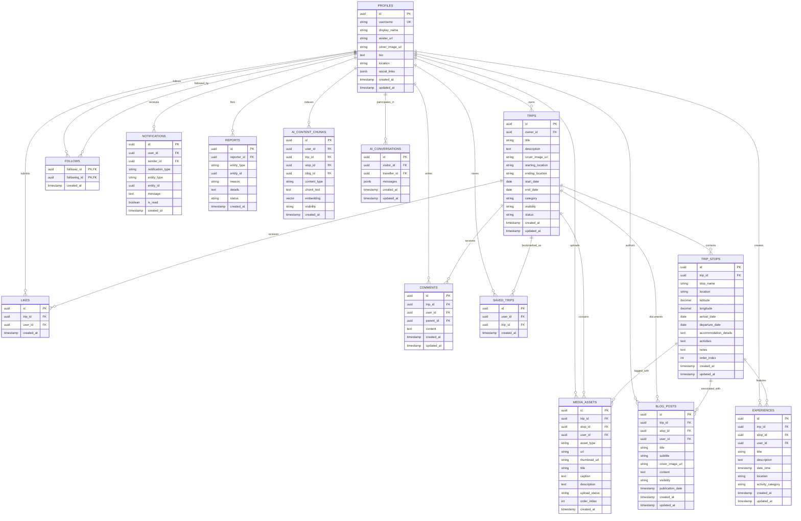

# Database Requirements & Relational Schema Specification
## Project: MICHI (道) — The Adventure Explorer Travel Social Platform

**Version:** 1.0  
**Status:** Approved Specification (Aligned with PRD v1.0 Section 10)  
**Date:** November 2026  
**Document Owner:** Database & Backend Engineering  

---

## 1. Database Overview & Core Principles

The MICHI database layer is hosted on **PostgreSQL** via **Supabase**, enhanced with the **pgvector** extension for semantic AI indexing.

Key design rules mandated by the PRD:
1. **Primary Keys**: UUID primary keys (`gen_random_uuid()`) for all entities.
2. **Auditing**: Every table includes `created_at` and `updated_at` timestamps.
3. **Owner Integrity**: Strict foreign-key constraints linking content to user profiles.
4. **Media Separation**: Actual image and video binary files are **never** stored in PostgreSQL; only URLs, dimensions, and metadata are persisted in `media_assets`.
5. **Privacy by Default**: PostgreSQL Row Level Security (RLS) policies enforce public/private visibility boundaries at the database layer.
6. **AI Metadata**: Vector embeddings in `ai_content_chunks` must retain user ownership and visibility metadata to ensure the AI chatbot never queries private content.

---

## 2. Entity-Relationship Diagram (ERD)



---

## 3. The 14 Database Tables & Schemas

### 3.1 `profiles`
User profile information linking 1-to-1 with Supabase `auth.users`.
```sql
CREATE TABLE public.profiles (
    id UUID PRIMARY KEY REFERENCES auth.users(id) ON DELETE CASCADE,
    username VARCHAR(32) UNIQUE NOT NULL,
    display_name VARCHAR(100) NOT NULL,
    avatar_url TEXT,
    cover_image_url TEXT,
    bio TEXT,
    location VARCHAR(100),
    social_links JSONB DEFAULT '{}'::jsonb,
    is_ai_chatbot_enabled BOOLEAN DEFAULT TRUE NOT NULL,
    created_at TIMESTAMPTZ DEFAULT NOW() NOT NULL,
    updated_at TIMESTAMPTZ DEFAULT NOW() NOT NULL
);
```

### 3.2 `trips`
Central trip entity organizing the entire journey.
```sql
CREATE TYPE trip_visibility AS ENUM ('public', 'private');
CREATE TYPE trip_status AS ENUM ('draft', 'published', 'archived');

CREATE TABLE public.trips (
    id UUID PRIMARY KEY DEFAULT gen_random_uuid(),
    owner_id UUID NOT NULL REFERENCES public.profiles(id) ON DELETE CASCADE,
    title VARCHAR(150) NOT NULL,
    description TEXT,
    cover_image_url TEXT,
    starting_location VARCHAR(255) NOT NULL,
    ending_location VARCHAR(255) NOT NULL,
    start_date DATE,
    end_date DATE,
    category VARCHAR(50) NOT NULL, -- Solo travel, Road trip, Backpacking, Family, Adventure, Trekking, Cultural, Beach, International, Other
    visibility trip_visibility DEFAULT 'private' NOT NULL,
    status trip_status DEFAULT 'draft' NOT NULL,
    created_at TIMESTAMPTZ DEFAULT NOW() NOT NULL,
    updated_at TIMESTAMPTZ DEFAULT NOW() NOT NULL,
    CONSTRAINT valid_dates CHECK (end_date IS NULL OR start_date IS NULL OR end_date >= start_date)
);
```

### 3.3 `trip_stops`
Intermediate destinations and chronological itinerary stops.
```sql
CREATE TABLE public.trip_stops (
    id UUID PRIMARY KEY DEFAULT gen_random_uuid(),
    trip_id UUID NOT NULL REFERENCES public.trips(id) ON DELETE CASCADE,
    stop_name VARCHAR(150) NOT NULL,
    location VARCHAR(255) NOT NULL,
    latitude NUMERIC(10, 7) NOT NULL,
    longitude NUMERIC(10, 7) NOT NULL,
    arrival_date DATE,
    departure_date DATE,
    accommodation_details TEXT,
    activities TEXT,
    notes TEXT,
    order_index INT NOT NULL,
    created_at TIMESTAMPTZ DEFAULT NOW() NOT NULL,
    updated_at TIMESTAMPTZ DEFAULT NOW() NOT NULL,
    CONSTRAINT valid_lat CHECK (latitude BETWEEN -90 AND 90),
    CONSTRAINT valid_lng CHECK (longitude BETWEEN -180 AND 180)
);
```

### 3.4 `experiences`
Documented individual activities and moments associated with trips and stops.
```sql
CREATE TABLE public.experiences (
    id UUID PRIMARY KEY DEFAULT gen_random_uuid(),
    trip_id UUID NOT NULL REFERENCES public.trips(id) ON DELETE CASCADE,
    stop_id UUID REFERENCES public.trip_stops(id) ON DELETE SET NULL,
    user_id UUID NOT NULL REFERENCES public.profiles(id) ON DELETE CASCADE,
    title VARCHAR(200) NOT NULL,
    description TEXT,
    date_time TIMESTAMPTZ,
    location VARCHAR(255),
    activity_category VARCHAR(50),
    created_at TIMESTAMPTZ DEFAULT NOW() NOT NULL,
    updated_at TIMESTAMPTZ DEFAULT NOW() NOT NULL
);
```

### 3.5 `blog_posts`
Long-form written travelogues and stories.
```sql
CREATE TABLE public.blog_posts (
    id UUID PRIMARY KEY DEFAULT gen_random_uuid(),
    trip_id UUID REFERENCES public.trips(id) ON DELETE SET NULL,
    stop_id UUID REFERENCES public.trip_stops(id) ON DELETE SET NULL,
    user_id UUID NOT NULL REFERENCES public.profiles(id) ON DELETE CASCADE,
    title VARCHAR(200) NOT NULL,
    subtitle VARCHAR(255),
    cover_image_url TEXT,
    content TEXT NOT NULL,
    visibility trip_visibility DEFAULT 'public' NOT NULL,
    publication_date TIMESTAMPTZ,
    created_at TIMESTAMPTZ DEFAULT NOW() NOT NULL,
    updated_at TIMESTAMPTZ DEFAULT NOW() NOT NULL
);
```

### 3.6 `media_assets`
Metadata for photographs and videos (actual media stored in media storage).
```sql
CREATE TYPE asset_type AS ENUM ('photo', 'video');
CREATE TYPE upload_status AS ENUM ('pending', 'processing', 'completed', 'failed');

CREATE TABLE public.media_assets (
    id UUID PRIMARY KEY DEFAULT gen_random_uuid(),
    trip_id UUID REFERENCES public.trips(id) ON DELETE CASCADE,
    stop_id UUID REFERENCES public.trip_stops(id) ON DELETE SET NULL,
    experience_id UUID REFERENCES public.experiences(id) ON DELETE SET NULL,
    user_id UUID NOT NULL REFERENCES public.profiles(id) ON DELETE CASCADE,
    asset_type asset_type DEFAULT 'photo' NOT NULL,
    url TEXT NOT NULL,
    thumbnail_url TEXT,
    title VARCHAR(150),
    caption TEXT,
    description TEXT,
    upload_status upload_status DEFAULT 'completed' NOT NULL,
    order_index INT DEFAULT 0,
    created_at TIMESTAMPTZ DEFAULT NOW() NOT NULL
);
```

### 3.7 `follows`
Unidirectional follow relationship between travellers.
```sql
CREATE TABLE public.follows (
    follower_id UUID NOT NULL REFERENCES public.profiles(id) ON DELETE CASCADE,
    following_id UUID NOT NULL REFERENCES public.profiles(id) ON DELETE CASCADE,
    created_at TIMESTAMPTZ DEFAULT NOW() NOT NULL,
    PRIMARY KEY (follower_id, following_id),
    CONSTRAINT self_follow_prevent CHECK (follower_id != following_id)
);
```

### 3.8 `likes`
Trip likes.
```sql
CREATE TABLE public.likes (
    id UUID PRIMARY KEY DEFAULT gen_random_uuid(),
    trip_id UUID NOT NULL REFERENCES public.trips(id) ON DELETE CASCADE,
    user_id UUID NOT NULL REFERENCES public.profiles(id) ON DELETE CASCADE,
    created_at TIMESTAMPTZ DEFAULT NOW() NOT NULL,
    CONSTRAINT unique_user_trip_like UNIQUE (user_id, trip_id)
);
```

### 3.9 `comments`
Social comments on trips with support for parent replies.
```sql
CREATE TABLE public.comments (
    id UUID PRIMARY KEY DEFAULT gen_random_uuid(),
    trip_id UUID NOT NULL REFERENCES public.trips(id) ON DELETE CASCADE,
    user_id UUID NOT NULL REFERENCES public.profiles(id) ON DELETE CASCADE,
    parent_id UUID REFERENCES public.comments(id) ON DELETE CASCADE,
    content TEXT NOT NULL,
    created_at TIMESTAMPTZ DEFAULT NOW() NOT NULL,
    updated_at TIMESTAMPTZ DEFAULT NOW() NOT NULL
);
```

### 3.10 `saved_trips`
Bookmarked journeys.
```sql
CREATE TABLE public.saved_trips (
    id UUID PRIMARY KEY DEFAULT gen_random_uuid(),
    user_id UUID NOT NULL REFERENCES public.profiles(id) ON DELETE CASCADE,
    trip_id UUID NOT NULL REFERENCES public.trips(id) ON DELETE CASCADE,
    created_at TIMESTAMPTZ DEFAULT NOW() NOT NULL,
    CONSTRAINT unique_user_saved_trip UNIQUE (user_id, trip_id)
);
```

### 3.11 `notifications`
User interaction notifications.
```sql
CREATE TABLE public.notifications (
    id UUID PRIMARY KEY DEFAULT gen_random_uuid(),
    user_id UUID NOT NULL REFERENCES public.profiles(id) ON DELETE CASCADE,
    sender_id UUID REFERENCES public.profiles(id) ON DELETE SET NULL,
    notification_type VARCHAR(50) NOT NULL, -- new_follower, trip_like, new_comment, comment_reply
    entity_type VARCHAR(50),
    entity_id UUID,
    message TEXT NOT NULL,
    is_read BOOLEAN DEFAULT FALSE NOT NULL,
    created_at TIMESTAMPTZ DEFAULT NOW() NOT NULL
);
```

### 3.12 `reports`
Content moderation and abuse reporting.
```sql
CREATE TABLE public.reports (
    id UUID PRIMARY KEY DEFAULT gen_random_uuid(),
    reporter_id UUID NOT NULL REFERENCES public.profiles(id) ON DELETE CASCADE,
    entity_type VARCHAR(50) NOT NULL, -- trip, blog, comment, user
    entity_id UUID NOT NULL,
    reason VARCHAR(100) NOT NULL,
    details TEXT,
    status VARCHAR(30) DEFAULT 'pending' NOT NULL, -- pending, reviewed, resolved, dismissed
    created_at TIMESTAMPTZ DEFAULT NOW() NOT NULL
);
```

### 3.13 `ai_content_chunks`
Vectorized public travel content for profile-specific RAG chatbot queries.
```sql
CREATE EXTENSION IF NOT EXISTS vector;

CREATE TABLE public.ai_content_chunks (
    id UUID PRIMARY KEY DEFAULT gen_random_uuid(),
    user_id UUID NOT NULL REFERENCES public.profiles(id) ON DELETE CASCADE,
    trip_id UUID REFERENCES public.trips(id) ON DELETE CASCADE,
    stop_id UUID REFERENCES public.trip_stops(id) ON DELETE CASCADE,
    blog_id UUID REFERENCES public.blog_posts(id) ON DELETE CASCADE,
    content_type VARCHAR(30) NOT NULL, -- stop_notes, experience, blog_excerpt, trip_summary
    chunk_text TEXT NOT NULL,
    embedding VECTOR(1536) NOT NULL, -- Vector dimensions matching embedding model
    visibility trip_visibility DEFAULT 'public' NOT NULL,
    created_at TIMESTAMPTZ DEFAULT NOW() NOT NULL
);

-- Crucial Index: HNSW vector search index
CREATE INDEX idx_ai_chunks_embedding ON public.ai_content_chunks 
USING hnsw (embedding vector_cosine_ops);

-- User and visibility index for strict privacy boundary
CREATE INDEX idx_ai_chunks_user_vis ON public.ai_content_chunks (user_id, visibility);
```

### 3.14 `ai_conversations`
Chat conversation history and session logs.
```sql
CREATE TABLE public.ai_conversations (
    id UUID PRIMARY KEY DEFAULT gen_random_uuid(),
    visitor_id UUID REFERENCES public.profiles(id) ON DELETE SET NULL,
    traveller_id UUID NOT NULL REFERENCES public.profiles(id) ON DELETE CASCADE,
    messages JSONB DEFAULT '[]'::jsonb NOT NULL,
    created_at TIMESTAMPTZ DEFAULT NOW() NOT NULL,
    updated_at TIMESTAMPTZ DEFAULT NOW() NOT NULL
);
```

---

## 4. Row Level Security (RLS) Strategy

All tables enable RLS. Private trips, media, blogs, and experiences are strictly isolated at the database engine level.

```sql
ALTER TABLE public.trips ENABLE ROW LEVEL SECURITY;
ALTER TABLE public.trip_stops ENABLE ROW LEVEL SECURITY;
ALTER TABLE public.blog_posts ENABLE ROW LEVEL SECURITY;
ALTER TABLE public.media_assets ENABLE ROW LEVEL SECURITY;
ALTER TABLE public.ai_content_chunks ENABLE ROW LEVEL SECURITY;

-- Trips RLS Policies
CREATE POLICY "Public trips are readable by everyone" 
ON public.trips FOR SELECT 
USING (visibility = 'public' AND status = 'published');

CREATE POLICY "Owners can view all their own trips" 
ON public.trips FOR SELECT 
USING (auth.uid() = owner_id);

CREATE POLICY "Owners can insert, update and delete their trips" 
ON public.trips FOR ALL 
USING (auth.uid() = owner_id);

-- AI Content Chunks RLS Policy: Never retrieve private content
CREATE POLICY "Only public chunks are searchable" 
ON public.ai_content_chunks FOR SELECT 
USING (visibility = 'public');
```

---

## 5. Cross-Reference Links

- Product Requirements Document: [PRD.md](PRD.md)
- System Architecture: [ARCHITECTURE.md](ARCHITECTURE.md)
- API Specifications: [API.md](API.md)
- Security Policies: [SECURITY.md](SECURITY.md)
