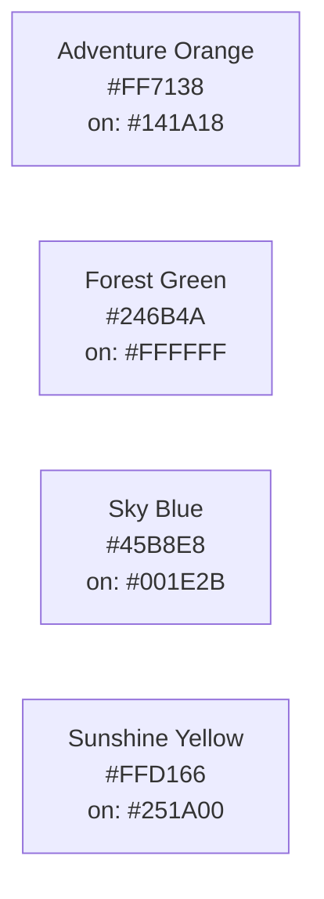

# Design System & Brand Identity
## Project: MICHI (道) — The Adventure Explorer Travel Social Platform

**Version:** 1.0  
**Status:** Approved Specification (Audited with Google Stitch Exports)  
**Date:** November 2026  
**Document Owner:** Brand & UI/UX Design Team (Google Stitch)  
**Export Reference:** [stitch_michi_travel_design_system/michi_design_system.md](file:///d:/travel%20social%20medio%20web/stitch_michi_travel_design_system/michi_design_system.md)  

---

## 1. Brand Identity & Design Direction

### 1.1 Brand Foundation
- **Product Name:** MICHI (道)
- **Etymology:** Japanese for *"Way"*, *"Road"*, or *"Path"*.
- **Tagline:** **Every Path Has a Story.**
- **Design Direction:** **Adventure Explorer**

The brand balances:
- **Grounded Outdoor Utility**: Inspired by trail markers, topographic maps, and outdoor field gear.
- **Japanese Visual Restraint**: Clean line geometry, generous whitespace, and the winding path seal (S-curve road with waypoint dot).
- **Anti-Slop Craftsmanship**: Strict avoidance of generic SaaS clutter, purple-to-blue neon gradients, and floating glassy blobs. Chrome remains calm so high-resolution travel photography and route maps lead.

---

## 2. Complete Color Token Specification

Extracted directly from the audited Stitch design tokens in [michi_design_system.md](file:///d:/travel%20social%20medio%20web/stitch_michi_travel_design_system/michi_design_system.md):

### 2.1 Brand Colors



| Color Token | Hex Code | Contrast Text | Semantic Purpose |
| :--- | :---: | :---: | :--- |
| `adventure-orange` | `#FF7138` | `#141A18` | Primary brand energy, trail markers, primary CTA buttons |
| `forest-green` | `#246B4A` | `#FFFFFF` | Primary action color in light mode, cedar canopies, nature stops |
| `sky-blue` | `#45B8E8` | `#001E2B` | Water routes, transit connections, links |
| `sunshine-yellow` | `#FFD166` | `#251A00` | Sights, pinned memories, milestone badges |

### 2.2 Light Mode Theme Tokens

| Token Name | Hex Value | Semantic Usage |
| :--- | :---: | :--- |
| `light-background` | `#F7F8F3` | Warm trail paper page background |
| `light-on-background` | `#141A18` | High-contrast body and heading text |
| `light-surface` | `#FFFFFF` | Crisp white card and dialog surfaces |
| `light-on-surface` | `#141A18` | Card title and body text |
| `light-surface-container` | `#ECF2EE` | Secondary button fills, tag backgrounds |
| `light-surface-container-high` | `#DEE4E0` | Hover states on container surfaces |
| `light-on-surface-variant` | `#424846` | Subtitles, captions, and secondary icons |
| `light-primary` | `#246B4A` | Primary interactive buttons and active links |
| `light-secondary` | `#CD4D15` | Accessible secondary orange when white text is required |
| `light-tertiary` | `#006687` | Deep cyan for transit highlights |
| `light-outline` | `#727875` | Input borders and high-visibility outlines |
| `light-outline-variant` | `#C2C8C4` | Subtle 1px hairline card borders |
| `light-error` | `#BA1A1A` | Form validation errors and destructive actions |

### 2.3 Dark Mode Theme Tokens

| Token Name | Hex Value | Semantic Usage |
| :--- | :---: | :--- |
| `dark-background` | `#141A18` | Deep pine-charcoal page canvas (never pure `#000000`) |
| `dark-on-background` | `#ECF2EE` | Off-white primary text |
| `dark-surface` | `#202925` | Moss-slate card and container surfaces |
| `dark-on-surface` | `#ECF2EE` | High-contrast card text |
| `dark-surface-container` | `#2C322F` | Elevated controls, search bars, and tags |
| `dark-surface-container-high` | `#38403C` | Hover states on dark containers |
| `dark-on-surface-variant` | `#C2C8C4` | Muted secondary text and timestamps |
| `dark-primary` | `#8FD6AD` | Soft sage green for primary actions in dark mode |
| `dark-secondary` | `#FF8C60` | Warm coral orange for dark mode highlights |
| `dark-tertiary` | `#71D2FF` | Luminous sky blue for transit links |
| `dark-outline` | `#8C928F` | Borders on dark inputs |
| `dark-outline-variant` | `#424846` | Subtle 1px borders for dark cards |
| `dark-error` | `#FFB4AB` | Dark mode error states |

---

## 3. Typography Hierarchy & Tokens

MICHI pairs **Manrope** (geometric, outdoor-inspired) for headings with **Inter** (crystal-clear legibility) for body copy.

```yaml
typography:
  display-lg: { fontFamily: "Manrope", fontSize: 56px, lineHeight: 62px, letterSpacing: -1.2px, fontWeight: 800 }
  display-lg-mobile: { fontFamily: "Manrope", fontSize: 32px, lineHeight: 38px, letterSpacing: -0.6px, fontWeight: 800 }
  display-md: { fontFamily: "Manrope", fontSize: 44px, lineHeight: 50px, letterSpacing: -0.8px, fontWeight: 800 }
  display-md-mobile: { fontFamily: "Manrope", fontSize: 28px, lineHeight: 34px, letterSpacing: -0.4px, fontWeight: 800 }
  headline-lg: { fontFamily: "Manrope", fontSize: 36px, lineHeight: 44px, letterSpacing: -0.5px, fontWeight: 700 }
  headline-lg-mobile: { fontFamily: "Manrope", fontSize: 24px, lineHeight: 30px, letterSpacing: -0.3px, fontWeight: 700 }
  headline-md: { fontFamily: "Manrope", fontSize: 24px, lineHeight: 32px, letterSpacing: -0.25px, fontWeight: 700 }
  title-lg: { fontFamily: "Manrope", fontSize: 20px, lineHeight: 28px, letterSpacing: -0.1px, fontWeight: 700 }
  title-md: { fontFamily: "Manrope", fontSize: 16px, lineHeight: 24px, letterSpacing: 0px, fontWeight: 600 }
  body-lg: { fontFamily: "Inter", fontSize: 16px, lineHeight: 26px, letterSpacing: 0px, fontWeight: 400 }
  body-md: { fontFamily: "Inter", fontSize: 14px, lineHeight: 22px, letterSpacing: 0px, fontWeight: 400 }
  label-lg: { fontFamily: "Inter", fontSize: 14px, lineHeight: 20px, letterSpacing: 0.1px, fontWeight: 600 }
  label-md: { fontFamily: "Inter", fontSize: 12px, lineHeight: 16px, letterSpacing: 0.2px, fontWeight: 600 }
  label-sm: { fontFamily: "Inter", fontSize: 11px, lineHeight: 14px, letterSpacing: 0.4px, fontWeight: 600 }
```

---

## 4. Spacing Scale & Corner Radii

### 4.1 Spacing Scale
- `gutter-xs`: `4px`
- `gutter-sm`: `8px`
- `gutter-md`: `16px`
- `gutter-lg`: `24px`
- `gutter-xl`: `32px`
- `section`: `48px`
- `page-margin`: `24px`

### 4.2 Corner Radii
- `rounded-sm`: `6px` (Checkboxes, small tags)
- `rounded-DEFAULT`: `12px` (Inputs, rectangular cards)
- `rounded-md`: `16px` (Card containers, drawers)
- `rounded-lg`: `20px` (Large journey cards, hero banners)
- `rounded-xl`: `28px` (Display panels)
- `rounded-full`: `9999px` (Pills, explorer CTA buttons, avatar rings)

---

## 5. Motion Tokens

- `state-change`: `120ms` with `ease-out` (hover, focus, and active button feedback).
- `surface-enter`: `240ms` with `cubic-bezier(0.2, 0, 0, 1)` (modal/drawer expansion, theme transition).
- `surface-exit`: `160ms` with `cubic-bezier(0.3, 0, 1, 1)` (modal dismiss, tooltip close).

---

## 6. Canonical Components (Stitch Sticker Sheets)

As exported in [michi_brand_identity_design_system/code.html](file:///d:/travel%20social%20medio%20web/stitch_michi_travel_design_system/michi_brand_identity_design_system/code.html):

### 6.1 Buttons
- **Primary CTA (`button-accent`)**: `bg-adventure-orange text-on-adventure-orange rounded-full px-gutter-lg py-3`.
- **Secondary Action (`button-primary`)**: `bg-light-primary text-light-on-primary dark:bg-dark-primary dark:text-dark-on-primary rounded-full px-gutter-lg py-3`.
- **Ghost Action**: `bg-light-surface-container dark:bg-dark-surface-container rounded-full px-gutter-md py-2`.

### 6.2 Cards
- **Journey Card (`card-interactive`)**: `rounded-lg border border-light-outline-variant dark:border-dark-outline-variant bg-light-surface dark:bg-dark-surface overflow-hidden hover:border-adventure-orange`.
- **Waypoint Timeline Node**: Connected via vertical track, displaying stop order number, arrival time, and distance pill.

### 6.3 Input Fields
- **Search Bar**: `rounded-full bg-light-background dark:bg-dark-background border border-light-outline-variant dark:border-dark-outline-variant pl-12 pr-gutter-md py-3.5`.
- **Form Text Field**: `rounded-DEFAULT bg-light-surface dark:bg-dark-surface border border-light-outline-variant dark:border-dark-outline-variant px-gutter-md py-3`.

---

## 7. Cross-Reference Links

- Stitch Design Audit: [STITCH_DESIGN_AUDIT.md](STITCH_DESIGN_AUDIT.md)
- UI/UX Guidelines: [UI_UX_GUIDELINES.md](UI_UX_GUIDELINES.md)
- Product Requirements Document: [PRD.md](PRD.md)
