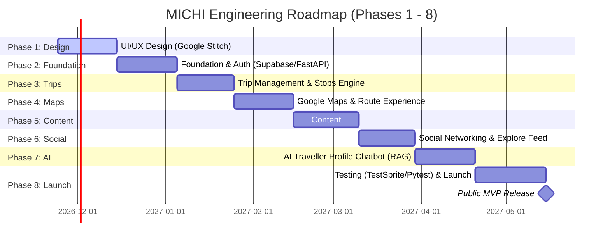

# Phase-by-Phase Development Roadmap
## Project: MICHI (道) — The Adventure Explorer Travel Social Platform

**Version:** 1.0  
**Status:** Approved Specification (Aligned with PRD v1.0 Section 14)  
**Date:** November 2026  
**Document Owner:** Engineering Leadership & Product Management  

---

## 1. Roadmap Overview & Timeline

The MICHI development lifecycle is structured into eight focused phases as defined in Section 14 of the PRD:

---

## 2. Phase Deliverables Breakdown

### Phase 1 — UI/UX Design
- **Tools**: Google Stitch.
- **Deliverables**:
  - Brand identity & Adventure Explorer design system.
  - Landing page & authentication screens (1–10).
  - Explore page & home feed (11–12).
  - Traveller profile & trip creation (13–18).
  - Journey map, trip details, and timeline (19).
  - Blogs, photo galleries, vlogs, and AI chatbot (20–29).
  - Light and Dark themes across desktop, tablet, and mobile.

### Phase 2 — Project Foundation and Authentication
- **Tools**: Antigravity, GitHub, Supabase, Vercel, and Render.
- **Deliverables**:
  - Git repository setup and branching workflow.
  - React + TypeScript frontend architecture on Vercel.
  - Python FastAPI backend architecture on Render.
  - PostgreSQL database foundation with Supabase Auth.
  - User profiles setup and deployment pipeline.

### Phase 3 — Trip Management
- **Deliverables**:
  - Create trips with start/end destinations, categories, and dates.
  - Edit trip information and cover photographs.
  - Save as draft and publish trips.
  - Add, delete, and reorder journey stops.
  - Enforce public/private access controls.

### Phase 4 — Maps and Journey Experience
- **Deliverables**:
  - Google Places API location autocomplete.
  - Google Maps JavaScript API interactive map integration.
  - Google Directions API route visualization.
  - Stop details popovers and marker selection.
  - Chronological journey timeline distinguishing start $\rightarrow$ stops $\rightarrow$ end.
  - Accommodation and activity documentation per stop.

### Phase 5 — Content Management
- **Deliverables**:
  - Photograph upload manager with captioning and responsive galleries.
  - Travel experience creation attached to stops.
  - Rich-text travel blog editor with preview and publishing.
  - Video upload pipeline to dedicated media storage.
  - Trip vlog galleries and embedded video players.

### Phase 6 — Social Networking
- **Deliverables**:
  - Explore page with category filters and search by destination/country.
  - Like trips and view like counts.
  - Comment on trips and view threaded discussions.
  - Following and unfollowing travellers.
  - Saved/bookmarked trips library.
  - In-app notification center.

### Phase 7 — AI Traveller Chatbot
- **Deliverables**:
  - Public trip, stop, and blog text chunking.
  - Semantic embedding generation.
  - Profile-specific vector retrieval using PostgreSQL with `pgvector`.
  - Grounded AI response generation citing source trips.
  - Strict privacy enforcement (never indexing or retrieving private content).
  - Chatbot usage controls (allow profile owners to disable chatbot).

### Phase 8 — Testing and Deployment
- **Deliverables**:
  - TestSprite automated UI tests across desktop and mobile.
  - Pytest unit and integration tests for FastAPI endpoints.
  - Rigorous privacy and authorization tests.
  - Performance optimization (lazy loading, caching, bundle reduction).
  - Final production deployment on Vercel and Render.

---

## 3. Product Acceptance Criteria for Launch (PRD Section 18)

The public MVP can be released when:
1. Users can register and log in securely.
2. Users can create and manage traveller profiles.
3. Users can create trips with starting and ending locations.
4. Users can add multiple destinations and stops.
5. Journeys are visualized on an interactive Google Map.
6. Users can add stop-wise experiences.
7. Users can upload photographs with galleries.
8. Users can publish travel blogs.
9. Users can upload and stream trip videos.
10. Users can select public or private visibility.
11. Visitors can explore public journeys and search destinations.
12. Users can follow, like, and comment.
13. Visitors can ask questions to a traveller's public AI chatbot.
14. AI answers cite relevant public sources.
15. Private content is 100% protected.
16. The application is responsive on desktop, tablet, and mobile.
17. Critical Pytest and TestSprite tests pass.
18. Production deployment is live and stable.

---

## 4. Cross-Reference Links

- Product Requirements Document: [PRD.md](PRD.md)
- Architecture Overview: [ARCHITECTURE.md](ARCHITECTURE.md)
- Testing Requirements: [TESTING.md](TESTING.md)
- Hosting Setup: [DEPLOYMENT.md](DEPLOYMENT.md)
