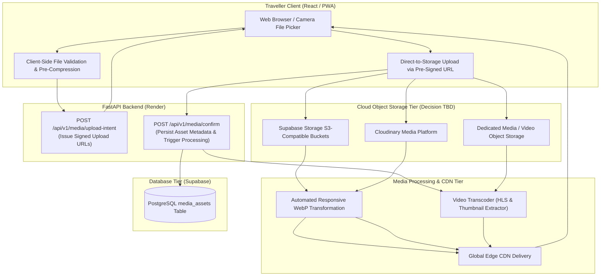
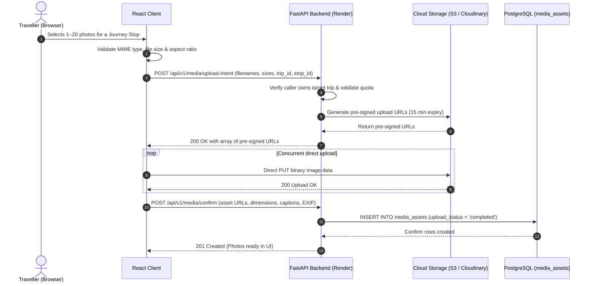

# Media Processing & Storage Pipeline Specification
## Project: MICHI (道) — The Adventure Explorer Travel Social Platform

**Version:** 1.0  
**Status:** Approved Specification (Aligned with PRD v1.0 Modules 8 & 9)  
**Date:** November 2026  
**Document Owner:** DevOps & Backend Engineering Team  
**Source of Truth:** [PRD.md](PRD.md)  

---

## 1. Pipeline Overview & Cardinal Rules

The MICHI platform enables travellers to preserve and share high-resolution travel photography, field journals, and cinematic journey vlogs.

### The Cardinal Media Rule (PRD Module 9)
> **CRITICAL RULE**: Actual image and video binary files are **strictly forbidden** from being stored directly in the PostgreSQL database. PostgreSQL stores only asset references, URLs, dimensions, and metadata in the `media_assets` table. All binary assets reside in specialized cloud object storage with CDN acceleration.

---

## 2. Media Architecture Topology



---

## 3. Supported Formats & File Size Limits

All file limits are strictly enforced both client-side before transmission and server-side via storage bucket policy constraints.

| Media Type | Supported MIME Types | Extensions | Recommended Max Size (TBD) | Target Resolution |
| :--- | :--- | :--- | :---: | :---: |
| **Photographs** | `image/jpeg`, `image/png`, `image/webp` | `.jpg`, `.jpeg`, `.png`, `.webp` | $15\text{ MB}$ per image (TBD) | Up to $4096 \times 4096\text{ px}$ |
| **Trip Cover Photos** | `image/jpeg`, `image/webp` | `.jpg`, `.jpeg`, `.webp` | $10\text{ MB}$ (TBD) | $1920 \times 1080\text{ px}$ (16:9) |
| **Profile & Avatar** | `image/jpeg`, `image/png`, `image/webp` | `.jpg`, `.png`, `.webp` | $5\text{ MB}$ (TBD) | $800 \times 800\text{ px}$ (1:1) |
| **Trip Vlogs & Videos** | `video/mp4`, `video/quicktime`, `video/webm` | `.mp4`, `.mov`, `.webm` | $200\text{ MB}$ per vlog (TBD) | 1080p ($1920 \times 1080$), 60fps |

*Note: RAW photograph formats (.cr2, .nef, .arw) must be converted to JPEG/WebP on the client device prior to upload.*

---

## 4. End-to-End Upload Pipelines

### 4.1 Photo Upload Workflow (FR-PHOTO-01 to 08)



### 4.2 Video & Vlog Upload Workflow (FR-VIDEO-01 to 08)

Because video processing is computationally expensive, video ingestion is decoupled from the main application backend:

1. **Pre-Signed Multi-Part Upload**: Video files ($> 50\text{ MB}$) use chunked multi-part uploads directly to dedicated object storage.
2. **Asynchronous Background Transcoding**:
   - The video is initially recorded in `media_assets` with `upload_status: 'processing'`.
   - A background worker on Render (or cloud webhook) generates HLS (`.m3u8`) streaming playlists and extracts three candidate thumbnail frames at 10%, 50%, and 90% of the video duration.
3. **Completion Broadcast**: Once transcoding finishes, `upload_status` updates to `'completed'`, and the selected thumbnail is saved to `thumbnail_url`.
4. **Failure Handling**: If transcoding fails (e.g. corrupt codec), `upload_status` transitions to `'failed'`, and a non-destructive notification alert is delivered to the user.

---

## 5. Metadata, Captions & Relational Associations

Every media asset logged on MICHI is explicitly mapped in the relational schema as defined in [DATABASE.md](DATABASE.md#36-media_assets):

- **Trip Association**: Every photo or video belongs to a parent `trip_id`.
- **Stop Association**: Optional `stop_id` links the media to a specific waypoint in the journey timeline.
- **Experience Association**: Optional `experience_id` links the media to a specific field moment (e.g., sunrise over Kasol).
- **Display Order**: `order_index` allows travellers to drag and reorder photographs in galleries (FR-PHOTO-07).
- **Captions & Descriptions**: Stored as text fields in `caption` and `description` (FR-PHOTO-02, FR-PHOTO-03).

---

## 6. Public vs. Private Media Access Control (Module 14)

Media inherit the visibility tier of their parent trip:

| Parent Trip State | Storage Accessibility | Delivery Mechanism |
| :--- | :--- | :--- |
| **Public Trip** | Public read access | Delivered via global CDN edge caching (`michi-cdn.travel/media/...`) |
| **Private Trip** | Restricted access | Delivered strictly via temporary signed URLs with 1-hour expiry, or served behind an authenticated edge proxy |
| **Draft Trip** | Restricted access | Accessible solely by the content owner (`auth.uid() = user_id`) |

> **Safety Rule**: Private media files must never be exposed via guessable, permanent public storage URLs.

---

## 7. Responsive Optimization & Image Delivery

To ensure rapid page load speeds across flaky cellular connections (mountain trails, rural trains):
1. **Automated WebP Conversion**: All uploaded JPEG/PNG assets are converted to modern WebP formats on ingestion.
2. **Dynamic Responsive srcset**:
   - Thumbnail: `320w` (for stop cards and explore grids)
   - Medium: `800w` (for feed timeline reading)
   - Large: `1600w` (for fullscreen lightbox inspection)
   - Original: Retained for high-resolution archive viewing
3. **Lazy Loading**: All images below the initial viewport fold use `loading="lazy"` and blur-up placeholder hashes.

---

## 8. Deletion & Retention Policies

- **User-Initiated Deletion (FR-PHOTO-08, FR-VIDEO-07)**:
  - Deleting an asset removes the `media_assets` row from PostgreSQL.
  - A database trigger or webhook enqueues a background deletion job to purge the original binary and thumbnail files from object storage.
- **Trip Deletion**:
  - Deleting a trip cascades to delete all linked `media_assets` rows and triggers bulk storage cleanup.
- **Account Deletion (FR-AUTH-09)**:
  - Initiates a complete purge of all media buckets associated with the user's ID within 24 hours.

---

## 9. API Integration (FastAPI Endpoints)

As documented in [API.md](API.md#27-media-management-photos--videos-apiv1media):

```http
POST /api/v1/media/upload-intent
Content-Type: application/json
Authorization: Bearer <JWT_TOKEN>
```

#### Request
```json
{
  "trip_id": "8f2b1a3c-4d5e-6f7a-8b9c-0d1e2f3a4b5c",
  "stop_id": "4d1a2b3c-5e6f-7a8b-9c0d-1e2f3a4b5c6d",
  "files": [
    {
      "filename": "himalayan_sunrise.jpg",
      "size_bytes": 4200000,
      "mime_type": "image/jpeg",
      "asset_type": "photo"
    }
  ]
}
```

#### Response
```json
{
  "success": true,
  "data": {
    "uploads": [
      {
        "filename": "himalayan_sunrise.jpg",
        "upload_url": "https://storage.supabase.co/v1/object/upload/sign/media/...",
        "asset_url": "https://storage.supabase.co/v1/object/public/media/...",
        "expires_in_seconds": 900
      }
    ]
  },
  "error": null
}
```

---

## 10. Architectural Decisions & Unresolved Items (TBD)

| Decision Item | Status | Proposal / Candidates | Open Considerations |
| :--- | :---: | :--- | :--- |
| **Primary Storage Provider** | **TBD** | Supabase Storage vs. Cloudinary | *Pending Phase 5 testing*: Supabase Storage keeps auth & storage in one vendor; Cloudinary provides automated on-the-fly transformations. |
| **Video Transcoding Engine** | **TBD** | Dedicated Render Worker vs. Cloudinary / Mux | Dedicated Render worker with `ffmpeg` vs. fully managed video streaming service. |
| **Max Video Size Limit** | **TBD** | $200\text{ MB}$ vs. $500\text{ MB}$ | Dependent on hosting tier storage budgets and upload bandwidth metrics. |
| **CDN Provider** | **TBD** | Cloudflare CDN vs. Fastly vs. Supabase Native | Cloudflare provides DDoS protection and global edge caching. |

---

## 11. Cross-Reference Links

- Product Requirements Document: [PRD.md](PRD.md)
- Database Schema & Tables: [DATABASE.md](DATABASE.md)
- System Architecture: [ARCHITECTURE.md](ARCHITECTURE.md)
- API Specifications: [API.md](API.md)
- Security & Privacy Policies: [SECURITY.md](SECURITY.md)
