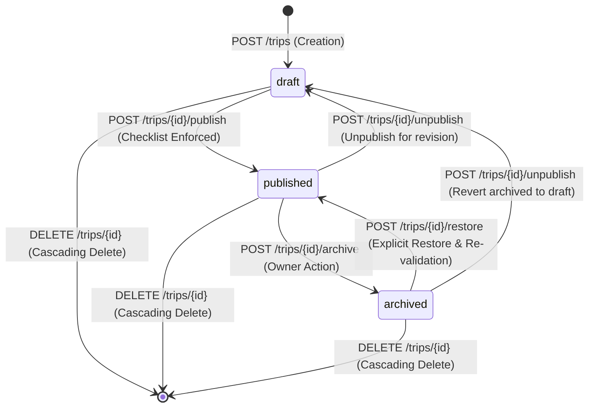

# MICHI (道) — Phase 3 API Design & Endpoint Specification

**Document Version:** 1.2 (Architecture Harmonization & Lifecycle Hardening)  
**Status:** Approved for Review (FastAPI Endpoint & Schema Specification)  
**Date:** November 2026  
**Authors:** Backend Engineering Team  
**Source of Truth:** [PRD.md](PRD.md), [API.md](API.md), [ARCHITECTURE.md](ARCHITECTURE.md), [SECURITY.md](SECURITY.md), [PHASE3_GAP_ANALYSIS.md](PHASE3_GAP_ANALYSIS.md)

---

## 1. Architectural Standards & Conventions

- **Base URL:** `/api/v1`
- **Protocol:** HTTPS RESTful JSON, UTF-8 encoded.
- **Authentication:** Supabase Bearer JWT passed via standard HTTP header:
  ```http
  Authorization: Bearer <SUPABASE_JWT_ACCESS_TOKEN>
  ```
- **Uniform Response Envelope:**
  ```json
  {
    "success": true,
    "data": { ... },
    "error": null
  }
  ```
- **Uniform Error Envelope:**
  ```json
  {
    "success": false,
    "data": null,
    "error": {
      "code": "PUBLISH_VALIDATION_FAILED",
      "message": "Trip cannot be published until all mandatory fields are provided.",
      "details": [
        "end_date cannot be earlier than start_date",
        "starting_location is required"
      ]
    }
  }
  ```
- **Database Dependency Injection:**
  - Authenticated operations use `get_db_for_authenticated_user` (applies `SET LOCAL ROLE authenticated` and user claims).
  - Conditional/public operations use `get_db_for_optional_user` (applies authenticated claims if token present, else `anon`).

---

## 2. Pydantic v2 Data Models & Schemas

### 2.1 Enums & Primitive Types

```python
from enum import Enum
from typing import Optional, List, Dict, Any
from datetime import date, datetime
from uuid import UUID
from pydantic import BaseModel, Field, field_validator, model_validator, ConfigDict


class TripVisibility(str, Enum):
    PUBLIC = "public"
    PRIVATE = "private"


class TripStatus(str, Enum):
    DRAFT = "draft"
    PUBLISHED = "published"
    ARCHIVED = "archived"


class TripCategory(str, Enum):
    SOLO_TRAVEL = "Solo travel"
    ROAD_TRIP = "Road trip"
    BACKPACKING = "Backpacking"
    FAMILY_TRIP = "Family trip"
    ADVENTURE = "Adventure"
    TREKKING = "Trekking"
    CULTURAL_EXPLORATION = "Cultural exploration"
    BEACH_VACATION = "Beach vacation"
    INTERNATIONAL_TRAVEL = "International travel"
    OTHER = "Other"
```

---

### 2.2 Trip Stop Schemas

```python
class TripStopBase(BaseModel):
    stop_name: str = Field(..., min_length=2, max_length=150, description="Name of destination/stop")
    location: str = Field(..., min_length=2, max_length=255, description="Address or geographic location")
    latitude: float = Field(..., ge=-90.0, le=90.0, description="WGS84 latitude")
    longitude: float = Field(..., ge=-180.0, le=180.0, description="WGS84 longitude")
    arrival_date: Optional[date] = None
    departure_date: Optional[date] = None
    accommodation_details: Optional[str] = Field(None, max_length=2000)
    activities: Optional[str] = Field(None, max_length=2000)
    notes: Optional[str] = Field(None, max_length=5000)

    @model_validator(mode="after")
    def validate_dates(self):
        if self.arrival_date and self.departure_date:
            if self.departure_date < self.arrival_date:
                raise ValueError("departure_date cannot be earlier than arrival_date")
        return self


class TripStopCreate(TripStopBase):
    pass


class TripStopUpdate(BaseModel):
    stop_name: Optional[str] = Field(None, min_length=2, max_length=150)
    location: Optional[str] = Field(None, min_length=2, max_length=255)
    latitude: Optional[float] = Field(None, ge=-90.0, le=90.0)
    longitude: Optional[float] = Field(None, ge=-180.0, le=180.0)
    arrival_date: Optional[date] = None
    departure_date: Optional[date] = None
    accommodation_details: Optional[str] = Field(None, max_length=2000)
    activities: Optional[str] = Field(None, max_length=2000)
    notes: Optional[str] = Field(None, max_length=5000)


class TripStopResponse(TripStopBase):
    id: UUID
    trip_id: UUID
    order_index: int
    created_at: datetime
    updated_at: datetime

    class Config:
        from_attributes = True


class TripStopReorderRequest(BaseModel):
    ordered_stop_ids: List[UUID] = Field(
        ...,
        min_length=1,
        description="Complete list of stop IDs in their intended sequence",
    )

    @field_validator("ordered_stop_ids")
    def validate_no_duplicates(cls, v):
        if len(v) != len(set(v)):
            raise ValueError("Duplicate stop IDs submitted in reorder sequence")
        return v
```

---

### 2.3 Trip Schemas

```python
class TripOwnerSnippet(BaseModel):
    id: UUID
    username: str
    display_name: str
    avatar_url: Optional[str] = None

    class Config:
        from_attributes = True


class TripBase(BaseModel):
    title: str = Field(..., min_length=3, max_length=150, description="Trip title")
    description: Optional[str] = Field(None, max_length=5000, description="Trip description")
    cover_image_url: Optional[str] = Field(None, description="Cover photograph URL")
    starting_location: str = Field(..., min_length=2, max_length=255, description="Origin location")
    ending_location: str = Field(..., min_length=2, max_length=255, description="Final destination")
    start_date: Optional[date] = None
    end_date: Optional[date] = None
    category: TripCategory = Field(default=TripCategory.OTHER)
    visibility: TripVisibility = Field(default=TripVisibility.PRIVATE)

    @model_validator(mode="after")
    def validate_trip_dates(self):
        if self.start_date and self.end_date:
            if self.end_date < self.start_date:
                raise ValueError("end_date cannot be earlier than start_date")
        return self


class TripCreate(TripBase):
    pass


class TripUpdate(BaseModel):
    """
    Schema for updating trip metadata.
    NOTE: 'status' is strictly excluded from TripUpdate to prevent unauthorized
    lifecycle bypass. All lifecycle transitions must use dedicated endpoints
    (/publish, /unpublish, /archive, /restore).
    """
    model_config = ConfigDict(extra="forbid")

    title: Optional[str] = Field(None, min_length=3, max_length=150)
    description: Optional[str] = Field(None, max_length=5000)
    cover_image_url: Optional[str] = None
    starting_location: Optional[str] = Field(None, min_length=2, max_length=255)
    ending_location: Optional[str] = Field(None, min_length=2, max_length=255)
    start_date: Optional[date] = None
    end_date: Optional[date] = None
    category: Optional[TripCategory] = None
    visibility: Optional[TripVisibility] = None

    @model_validator(mode="after")
    def validate_trip_dates(self):
        if self.start_date and self.end_date:
            if self.end_date < self.start_date:
                raise ValueError("end_date cannot be earlier than start_date")
        return self


class TripPublishRequest(BaseModel):
    """
    Optional payload when publishing a trip to confirm or override visibility.
    """
    visibility: Optional[TripVisibility] = Field(
        None,
        description="Explicitly set or confirm visibility on publication ('public' or 'private'). Defaults to current trip visibility (or 'private')."
    )


class TripResponse(TripBase):
    id: UUID
    owner_id: UUID
    status: TripStatus
    created_at: datetime
    updated_at: datetime
    owner: TripOwnerSnippet
    stops_count: int = 0
    stops: List[TripStopResponse] = []

    class Config:
        from_attributes = True


class TripListItem(BaseModel):
    id: UUID
    owner_id: UUID
    title: str
    description: Optional[str] = None
    cover_image_url: Optional[str] = None
    starting_location: str
    ending_location: str
    start_date: Optional[date] = None
    end_date: Optional[date] = None
    category: TripCategory
    visibility: TripVisibility
    status: TripStatus
    created_at: datetime
    stops_count: int = 0
    owner: TripOwnerSnippet

    class Config:
        from_attributes = True


class PaginatedTripList(BaseModel):
    items: List[TripListItem]
    total: int
    page: int
    page_size: int
    has_more: bool
```

---

## 3. Trip Management Endpoints (`/api/v1/trips`)

### 3.1 Create Trip
- **Endpoint:** `POST /api/v1/trips`
- **Auth Required:** Yes (Authenticated User)
- **Summary:** Create a new journey itinerary in `draft` status.
- **Request Body:** `TripCreate`
- **Response Model:** `APIResponse[TripResponse]`
- **Status Code:** `201 Created`

---

### 3.2 List My Trips (User Dashboard)
- **Endpoint:** `GET /api/v1/trips`
- **Auth Required:** Yes (Authenticated User)
- **Summary:** Retrieve all trips owned by current authenticated user, including drafts and archived journeys.
- **Query Parameters:**
  - `status`: Optional filter (`draft`, `published`, `archived`)
  - `page`: int (default `1`)
  - `page_size`: int (default `20`, max `100`)
- **Response Model:** `APIResponse[PaginatedTripList]`
- **Status Code:** `200 OK`

---

### 3.3 List Public Trips (Community Explore)
- **Endpoint:** `GET /api/v1/trips/public`
- **Auth Required:** No (Public / Anonymous)
- **Summary:** Retrieve paginated community published journeys (`visibility = 'public' AND status = 'published'`).
- **Query Parameters:**
  - `category`: Optional string filter
  - `page`: int (default `1`)
  - `page_size`: int (default `20`)
- **Response Model:** `APIResponse[PaginatedTripList]`
- **Status Code:** `200 OK`

---

### 3.4 Get Trip Details
- **Endpoint:** `GET /api/v1/trips/{trip_id}`
- **Auth Required:** Conditional
- **Summary:** Retrieve full trip information, stops, and timeline.
- **Authorization Rules:**
  - If `visibility = 'public'` and `status = 'published'`: Accessible by any visitor or user.
  - If `visibility = 'private'` or `status = 'draft'`: Accessible **only** by trip owner (`auth.uid() = owner_id`). Non-owners receive `403 Forbidden`.
- **Response Model:** `APIResponse[TripResponse]`
- **Status Code:** `200 OK`
- **Error Codes:**
  - `403 Forbidden`: `PERMISSION_DENIED` ("This trip is private and cannot be viewed by visitors.")
  - `404 Not Found`: `RESOURCE_NOT_FOUND` ("Trip does not exist.")

---

### 3.5 Edit Trip
- **Endpoint:** `PATCH /api/v1/trips/{trip_id}`
- **Auth Required:** Yes (Trip Owner Only)
- **Summary:** Update metadata, cover photo, category, dates, or visibility.
- **Request Body:** `TripUpdate`
- **Lifecycle Integrity Note:** `TripUpdate` model strictly excludes `status` (`extra = 'forbid'`). Any attempt to alter `status` via `PATCH /trips/{trip_id}` is rejected with `422 Unprocessable Entity`. All lifecycle transitions must be performed through dedicated lifecycle endpoints (`/publish`, `/unpublish`, `/archive`, `/restore`).
- **Response Model:** `APIResponse[TripResponse]`
- **Status Code:** `200 OK`
- **Error Codes:**
  - `403 Forbidden`: `PERMISSION_DENIED` ("You do not have permission to modify this trip.")
  - `422 Unprocessable Entity`: `VALIDATION_ERROR` (Validation failure or forbidden extra fields passed).

---

### 3.6 Delete Trip
- **Endpoint:** `DELETE /api/v1/trips/{trip_id}`
- **Auth Required:** Yes (Trip Owner Only)
- **Summary:** Permanently delete a trip and all its associated journey stops (cascading). Permitted on trips in any status (`draft`, `published`, `archived`).
- **Response Model:** `APIResponse[dict]` (e.g. `{"deleted": true, "id": "..."}`)
- **Status Code:** `200 OK`

---

### 3.7 Publish Trip (Checklist Enforcement)
- **Endpoint:** `POST /api/v1/trips/{trip_id}/publish`
- **Auth Required:** Yes (Trip Owner Only)
- **Summary:** Transition a draft journey to `published`.
- **Request Body:** `Optional[TripPublishRequest] = None` (Allows optional visibility confirmation/override; defaults to current visibility or `private`).
- **Mandatory Publishing Checklist:**
  1. `title`: Non-empty string, min 3 characters.
  2. `category`: Valid PRD category.
  3. `starting_location`: Non-empty string.
  4. `ending_location`: Non-empty string.
  5. `start_date` and `end_date`: Both populated, and `end_date >= start_date`.
  6. **Stops Validation (PRD Truth Audit):** Intermediate stops are optional in PRD Module 3 (FR-TRIP-05: "Users can add multiple stops"). Point-to-point journeys with 0 stops are fully valid to publish. If intermediate stops exist, all must be valid.
  7. `visibility`: Confirmed (defaults to `private` if unset).
- **Response Model:** `APIResponse[TripResponse]`
- **Status Code:** `200 OK`
- **Error Codes:**
  - `422 Unprocessable Entity`: `PUBLISH_VALIDATION_FAILED` (Details contain list of unmet requirements).
  - `422 Unprocessable Entity`: `INVALID_STATE_TRANSITION` (Trip is not in `draft` status).
  - `403 Forbidden`: `PERMISSION_DENIED` (Non-owner).

---

### 3.8 Archive Trip
- **Endpoint:** `POST /api/v1/trips/{trip_id}/archive`
- **Auth Required:** Yes (Trip Owner Only)
- **Summary:** Transition a published journey to `archived` (hides from public feeds while retaining owner access).
- **Validation:** Permitted only when current `status == 'published'`.
- **Response Model:** `APIResponse[TripResponse]`
- **Status Code:** `200 OK`
- **Error Codes:**
  - `422 Unprocessable Entity`: `INVALID_STATE_TRANSITION` (Trip is not in `published` status).

---

### 3.9 Restore Trip (Explicit Restoration)
- **Endpoint:** `POST /api/v1/trips/{trip_id}/restore`
- **Auth Required:** Yes (Trip Owner Only)
- **Summary:** Transition an archived journey back to `published`.
- **Validation:** Permitted only when current `status == 'archived'`. Re-validates the mandatory publishing checklist.
- **Response Model:** `APIResponse[TripResponse]`
- **Status Code:** `200 OK`
- **Error Codes:**
  - `422 Unprocessable Entity`: `INVALID_STATE_TRANSITION` (Trip is not in `archived` status).
  - `422 Unprocessable Entity`: `PUBLISH_VALIDATION_FAILED` (Checklist unmet).

---

### 3.10 Unpublish Trip (Dedicated Transition to Draft)
- **Endpoint:** `POST /api/v1/trips/{trip_id}/unpublish`
- **Auth Required:** Yes (Trip Owner Only)
- **Summary:** Transition a `published` (or `archived`) journey back to `draft` for revisions and major editing.
- **Validation:** Permitted when current `status IN ('published', 'archived')`.
- **Response Model:** `APIResponse[TripResponse]`
- **Status Code:** `200 OK`
- **Error Codes:**
  - `422 Unprocessable Entity`: `INVALID_STATE_TRANSITION` (Trip is already in `draft` status).
  - `403 Forbidden`: `PERMISSION_DENIED` (Non-owner).

---

## 4. Journey Stop Endpoints (`/api/v1/trips/{trip_id}/stops`)

### 4.1 List Stops
- **Endpoint:** `GET /api/v1/trips/{trip_id}/stops`
- **Auth Required:** Conditional (inherits trip readability)
- **Summary:** Get all stops for a trip ordered chronologically by `order_index ASC`.
- **Response Model:** `APIResponse[List[TripStopResponse]]`
- **Status Code:** `200 OK`

---

### 4.2 Add Stop (Parent Trip Lock & Sequential Indexing)
- **Endpoint:** `POST /api/v1/trips/{trip_id}/stops`
- **Auth Required:** Yes (Trip Owner Only)
- **Summary:** Append a new stop/waypoint to the journey. Automatically assigns the next sequential `order_index`.
- **Concurrency & Pessimistic Locking:**
  - Acquires exclusive row-level lock on parent trip: `SELECT id, owner_id FROM trips WHERE id = :trip_id FOR UPDATE;` (via SQLAlchemy `with_for_update()`).
  - Serializes concurrent additions, preventing race conditions on `MAX(order_index) + 1` and guaranteeing unique sequence order.
- **Ownership Verification:** Verifies caller owns parent `trip_id`.
- **Request Body:** `TripStopCreate`
- **Response Model:** `APIResponse[TripStopResponse]`
- **Status Code:** `201 Created`

---

### 4.3 Edit Stop (Stop Ownership & Binding Verification)
- **Endpoint:** `PATCH /api/v1/trips/{trip_id}/stops/{stop_id}`
- **Auth Required:** Yes (Trip Owner Only)
- **Summary:** Modify details, coordinates, activities, or notes for a stop.
- **Ownership & Binding Rules:**
  1. Verifies caller owns `trip_id`.
  2. Queries target stop by `stop_id`.
  3. **Rejection of Foreign Stop IDs:** Verifies `stop.trip_id == trip_id`. If stop belongs to another trip, returns `404 Not Found` (or `400 Bad Request`).
- **Request Body:** `TripStopUpdate`
- **Response Model:** `APIResponse[TripStopResponse]`
- **Status Code:** `200 OK`

---

### 4.4 Remove Stop (Parent Lock & Sequence Normalization)
- **Endpoint:** `DELETE /api/v1/trips/{trip_id}/stops/{stop_id}`
- **Auth Required:** Yes (Trip Owner Only)
- **Summary:** Remove a stop from the trip. Automatically re-indexes subsequent stops to maintain a continuous `order_index` sequence ($0, 1, 2...$).
- **Concurrency & Pessimistic Locking:**
  - Acquires exclusive row-level lock on parent trip: `SELECT id FROM trips WHERE id = :trip_id FOR UPDATE;`.
  - Deletes target stop and decrements `order_index` of all stops with `order_index > deleted_order_index` within the same transaction.
- **Ownership & Binding Rules:**
  1. Verifies caller owns `trip_id`.
  2. Verifies target stop belongs to `trip_id`. Rejects foreign stop IDs with `404 Not Found`.
- **Response Model:** `APIResponse[dict]` (e.g. `{"deleted": true, "id": "..."}`)
- **Status Code:** `200 OK`

---

### 4.5 Batch Reorder Stops (Atomic & Collision-Free Reordering Engine)
- **Endpoint:** `PUT /api/v1/trips/{trip_id}/stops/reorder`
- **Auth Required:** Yes (Trip Owner Only)
- **Summary:** Re-sequence all stops of a trip within a single atomic database transaction.
- **Request Body:** `TripStopReorderRequest`
  ```json
  {
    "ordered_stop_ids": [
      "d3b07384-d113-4944-9c8e-32491a67a001",
      "d3b07384-d113-4944-9c8e-32491a67a002",
      "d3b07384-d113-4944-9c8e-32491a67a003"
    ]
  }
  ```
- **Validation Rules:**
  1. **Duplicate Check:** Pydantic rejects list containing duplicate UUIDs with 422 (`DUPLICATE_STOP_IDS`).
  2. **Count & Omission Check:** Queries all existing stop IDs for `trip_id`.
     - **Empty Stop List (`[]`):** If the trip currently has 0 stops, submitting `[]` succeeds as an idempotent no-op returning `[]` with `200 OK`. If the trip has $N > 0$ stops, submitting `[]` fails the count check ($0 \ne N$) and is rejected with 422 (`INCOMPLETE_STOP_SEQUENCE`), preventing accidental deletion of stops via reorder.
     - **Omission Check:** `len(ordered_stop_ids)` must equal existing stop count. If any existing stop ID is omitted, rejects with 422 (`INCOMPLETE_STOP_SEQUENCE`).
  3. **Foreign Stop Check:** Every ID in `ordered_stop_ids` must belong to `trip_id`. If any ID belongs to another trip or does not exist, rejects with 422 (`FOREIGN_STOP_ID`).
  4. **Integer Overflow Guard:** Queries `current_max = MAX(order_index)` for `trip_id`. If `current_max > 1_000_000_000` (`SAFE_MAX_ORDER_INDEX`), rejects with 422 (`ORDER_INDEX_OVERFLOW`) before any database mutations occur.
- **Concurrency & Pessimistic Locking:**
  - On PostgreSQL: Acquires exclusive row-level lock on parent trip: `SELECT id, owner_id FROM trips WHERE id = :trip_id FOR UPDATE;` (via SQLAlchemy `with_for_update()`). Any concurrent reorder, add, or delete operation for the same trip row is blocked at the database engine level until transaction commit.
  - On SQLite (Local Unit Tests): SQLite does not support `SELECT ... FOR UPDATE` or `DEFERRABLE` unique constraints; it serializes writes via database-level transaction locks (`BEGIN IMMEDIATE`). SQLite tests verify schema mapping and validation logic, while real row locking is verified in PostgreSQL integration tests.
- **Collision-Free Two-Phase Positive Disjoint Offset Strategy:**
  - The database schema enforces `CONSTRAINT valid_order_index CHECK (order_index >= 0)` and `CONSTRAINT uq_trip_stops_trip_order UNIQUE (trip_id, order_index) DEFERRABLE INITIALLY DEFERRED`.
  - Because PostgreSQL **CHECK constraints cannot be deferred**, temporary negative numbers are forbidden and immediately raise error `23514`.
  - To guarantee total non-negative compliance, prevent 32-bit signed integer overflow, seamlessly normalize non-contiguous existing indices, and ensure zero duplicate key collisions across both SQLite and PostgreSQL, the engine executes a **Two-Phase Positive Disjoint Offset Update**:
    - **Compute Safe Disjoint Offset & Guard Overflow:**
      - `current_max = (SELECT COALESCE(MAX(order_index), 0) FROM trip_stops WHERE trip_id = :trip_id)`.
      - Guard: If `current_max > 1_000_000_000`, immediately abort and raise HTTP 422 (`ORDER_INDEX_OVERFLOW`).
      - Safe offset calculation: `safe_offset = current_max + 1000` ($safe\_offset \ge 1000$).
      - **Mathematical Proof of No Overflow:**  
        $$\max(\text{shifted\_index}) \le 1,000,000,000 + (1,000,000,000 + 1000) = 2,000,001,000 < 2,147,483,647 \quad (\text{INT4\_MAX})$$
        No shifted value can exceed 32-bit signed integer capacity.
    - **Handling Non-Contiguous Existing Indices:**
      - If existing stops have non-contiguous indices (e.g. $0, 50, 9999$ due to prior deletions or manual migrations), shifting by $+safe\_offset$ is strictly injective ($x \ne y \implies x + c \ne y + c$), preserving distinctness.
      - In Phase 2, target indices $0, \dots, N - 1$ are assigned sequentially, automatically normalizing the sequence and eliminating all gaps without collision.
    - **Phase 1 (Shift to Disjoint Positive Range):**  
      `UPDATE trip_stops SET order_index = order_index + :safe_offset WHERE trip_id = :trip_id;`  
      All stops for the trip shift into $[safe\_offset, safe\_offset + current\_max]$. Since all values are $\ge 1000 > 0$, `CHECK (order_index >= 0)` is strictly satisfied on every row. Mutual distinctness is preserved, and the shifted range is completely disjoint from the final target sequence $[0, N - 1]$.
    - **Phase 2 (Assign Target Indices):** For each `(target_idx, stop_id)` in `enumerate(ordered_stop_ids)`:  
      `UPDATE trip_stops SET order_index = :target_idx WHERE id = :stop_id;`  
      Each stop updates to its target position in $[0, N - 1]$. Since $[0, N - 1]$ has zero overlap with $[safe\_offset, safe\_offset + current\_max]$, no intermediate assignment ever collides with an unshifted stop.
  - **Transaction Atomicity:** If any error occurs during Phase 1, Phase 2, or validation, the transaction rolls back completely, restoring the pristine sequence with zero residual offset.
- **Response Model:** `APIResponse[List[TripStopResponse]]`
- **Status Code:** `200 OK`

---

## 5. Lifecycle State Transition Matrix



| Source State | Target State | Permitted API Action | Guard / Validation |
| :--- | :--- | :--- | :--- |
| `[None]` | `draft` | `POST /trips` | Authenticated user creates initial draft |
| `draft` | `published` | `POST /trips/{id}/publish` | Mandatory publishing checklist (title, dates, category, locations) |
| `published` | `archived` | `POST /trips/{id}/archive` | Owner action; hides from public feeds |
| `archived` | `published` | `POST /trips/{id}/restore` | Owner action; re-validates publishing checklist |
| `published` | `draft` | `POST /trips/{id}/unpublish` | Dedicated unpublish endpoint; enables editing |
| `archived` | `draft` | `POST /trips/{id}/unpublish` | Dedicated unpublish endpoint; enables editing |
| `Any` | `Deleted` | `DELETE /trips/{id}` | Cascading purge of trip and child stops |

> [!NOTE]
> `PATCH /api/v1/trips/{id}` NEVER mutates trip status. Calling PATCH with `status` is rejected with HTTP 422 (`extra_forbidden`).

---

## 6. Standardized Error Codes & HTTP Mapping

| HTTP Code | Error Code | Description / Trigger Scenario |
| :---: | :--- | :--- |
| **`400`** | `BAD_REQUEST` | Malformed JSON or invalid parameter syntax |
| **`401`** | `UNAUTHORIZED` | Missing, expired, or invalid Supabase Bearer JWT token |
| **`403`** | `PERMISSION_DENIED` | Visitor trying to read private trip, or non-owner trying to mutate |
| **`404`** | `RESOURCE_NOT_FOUND` | Trip not found, or stop not found within specified trip |
| **`422`** | `VALIDATION_ERROR` | Schema validation failure (lat > 90, end_date < start_date, extra fields) |
| **`422`** | `DUPLICATE_STOP_IDS` | Reorder payload contains duplicate stop IDs |
| **`422`** | `INCOMPLETE_STOP_SEQUENCE` | Reorder payload omits existing stops belonging to the trip |
| **`422`** | `FOREIGN_STOP_ID` | Reorder payload contains stop IDs belonging to a different trip |
| **`422`** | `ORDER_INDEX_OVERFLOW` | Maximum existing order_index exceeds safe boundary (1,000,000,000) |
| **`422`** | `PUBLISH_VALIDATION_FAILED`| Mandatory checklist not met (e.g. missing dates, locations, or title) |
| **`422`** | `INVALID_STATE_TRANSITION` | Attempting an illegal lifecycle transition (e.g. publishing an archived trip) |
| **`500`** | `INTERNAL_SERVER_ERROR` | Unexpected unhandled server exception |
