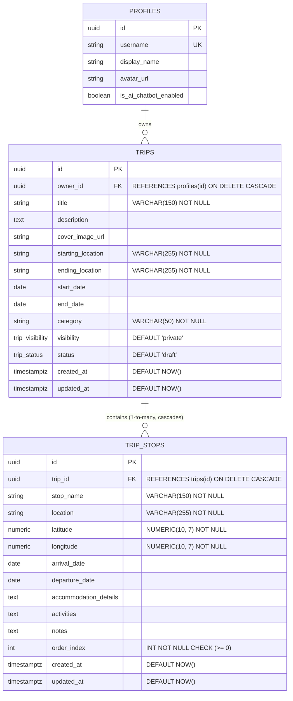

# MICHI (道) — Phase 3 Database Design & Schema Specification

**Document Version:** 1.2 (Final Architecture Corrections Revision)  
**Status:** Approved for Review (Relational Data & RLS Architecture)  
**Date:** November 2026  
**Authors:** Database Engineer & Lead Architect  
**Source of Truth:** [PRD.md](PRD.md), [DATABASE.md](DATABASE.md), [SECURITY.md](SECURITY.md), [PHASE3_GAP_ANALYSIS.md](PHASE3_GAP_ANALYSIS.md)

---

## 1. Relational Model & Entity Relationships

Phase 3 introduces the core journey tables in the `public` schema: `trips` and `trip_stops`.



---

## 2. Table Specifications & Constraints

### 2.1 PostgreSQL Custom Types (ENUMs)

```sql
-- 1. Trip Visibility ENUM (PRD Module 3 & 14)
CREATE TYPE trip_visibility AS ENUM ('public', 'private');

-- 2. Trip Status Lifecycle ENUM (PRD Module 3 Lifecycle: Draft -> Published -> Archived)
CREATE TYPE trip_status AS ENUM ('draft', 'published', 'archived');
```

---

### 2.2 Table `public.trips`

Stores top-level journey itineraries.

| Column | Type | Nullable | Default | Description / Constraint |
| :--- | :--- | :---: | :---: | :--- |
| `id` | `UUID` | No | `gen_random_uuid()` | Primary Key |
| `owner_id` | `UUID` | No | - | Foreign Key $\rightarrow$ `public.profiles(id)` `ON DELETE CASCADE` |
| `title` | `VARCHAR(150)` | No | - | Journey title (min 3 chars) |
| `description` | `TEXT` | Yes | `NULL` | Journey summary / overview |
| `cover_image_url` | `TEXT` | Yes | `NULL` | Header cover photograph URL |
| `starting_location` | `VARCHAR(255)` | No | - | Origin destination name |
| `ending_location` | `VARCHAR(255)` | No | - | Final destination name |
| `start_date` | `DATE` | Yes | `NULL` | Journey start date |
| `end_date` | `DATE` | Yes | `NULL` | Journey end date |
| `category` | `VARCHAR(50)` | No | `'Other'` | Trip category (Must be 1 of 10 PRD categories) |
| `visibility` | `trip_visibility`| No | `'private'` | Public or Private visibility boundary (Default `'private'`) |
| `status` | `trip_status` | No | `'draft'` | Lifecycle status (`draft`, `published`, `archived`) |
| `created_at` | `TIMESTAMPTZ` | No | `NOW()` | Audit timestamp |
| `updated_at` | `TIMESTAMPTZ` | No | `NOW()` | Audit timestamp (auto-updated by trigger) |

#### Constraints & Validation Rules:
1. `valid_dates`:
   $$\text{end\_date} \ge \text{start\_date} \quad \text{when both dates are not null}$$
   ```sql
   CONSTRAINT valid_dates CHECK (end_date IS NULL OR start_date IS NULL OR end_date >= start_date)
   ```
2. `valid_category`:
   ```sql
   CONSTRAINT valid_category CHECK (category IN (
       'Solo travel', 'Road trip', 'Backpacking', 'Family trip', 'Adventure',
       'Trekking', 'Cultural exploration', 'Beach vacation', 'International travel', 'Other'
   ))
   ```

#### Indexes:
- `idx_trips_owner_id`: B-Tree index on `owner_id` (accelerates user dashboard queries).
- `idx_trips_visibility_status`: Composite B-Tree index on `(visibility, status)` (optimizes public community feed queries).
- `idx_trips_created_at`: B-Tree index on `created_at DESC` (for feed ordering).

---

### 2.3 Table `public.trip_stops` & Sequence Uniqueness Evaluation

Stores ordered intermediate waypoints along a journey.

| Column | Type | Nullable | Default | Description / Constraint |
| :--- | :--- | :---: | :---: | :--- |
| `id` | `UUID` | No | `gen_random_uuid()` | Primary Key |
| `trip_id` | `UUID` | No | - | Foreign Key $\rightarrow$ `public.trips(id)` `ON DELETE CASCADE` |
| `stop_name` | `VARCHAR(150)` | No | - | Name of waypoint/stop |
| `location` | `VARCHAR(255)` | No | - | Address / geographic place name |
| `latitude` | `NUMERIC(10, 7)`| No | - | WGS84 Latitude ($-90.0000000$ to $+90.0000000$) |
| `longitude`| `NUMERIC(10, 7)`| No | - | WGS84 Longitude ($-180.0000000$ to $+180.0000000$) |
| `arrival_date` | `DATE` | Yes | `NULL` | Date traveller arrived at stop |
| `departure_date`| `DATE` | Yes | `NULL` | Date traveller departed from stop |
| `accommodation_details`| `TEXT` | Yes | `NULL` | Hotel, hostel, campsite, or stay notes |
| `activities` | `TEXT` | Yes | `NULL` | Summary of activities undertaken |
| `notes` | `TEXT` | Yes | `NULL` | Travel tips, costs, or personal observations |
| `order_index` | `INT` | No | `0` | Sequential waypoint position ($0, 1, 2...$) |
| `created_at` | `TIMESTAMPTZ` | No | `NOW()` | Audit timestamp |
| `updated_at` | `TIMESTAMPTZ` | No | `NOW()` | Audit timestamp (auto-updated by trigger) |

#### Constraints & Validation Rules:
1. `valid_lat`:
   $$-90 \le \text{latitude} \le 90$$
   ```sql
   CONSTRAINT valid_lat CHECK (latitude BETWEEN -90.0000000 AND 90.0000000)
   ```
2. `valid_lng`:
   $$-180 \le \text{longitude} \le 180$$
   ```sql
   CONSTRAINT valid_lng CHECK (longitude BETWEEN -180.0000000 AND 180.0000000)
   ```
3. `valid_stop_dates`:
   ```sql
   CONSTRAINT valid_stop_dates CHECK (departure_date IS NULL OR arrival_date IS NULL OR departure_date >= arrival_date)
   ```
4. `valid_order_index`:
   ```sql
   CONSTRAINT valid_order_index CHECK (order_index >= 0)
   ```
5. `uq_trip_stops_trip_order`:
   ```sql
   CONSTRAINT uq_trip_stops_trip_order UNIQUE (trip_id, order_index) DEFERRABLE INITIALLY DEFERRED
   ```

#### Evaluation of Unique, Non-Negative, and Integer Boundary Constraints on `(trip_id, order_index)`:
- In relational databases, a unique constraint on `(trip_id, order_index)` causes collisions during sequence updates if intermediate values overlap existing values (e.g., swapping stop 0 and stop 1).
- Furthermore, the table schema enforces `CONSTRAINT valid_order_index CHECK (order_index >= 0)`. In PostgreSQL, **CHECK constraints cannot be deferred**; they are evaluated immediately upon each row modification. Therefore, temporary negative offsets (such as `order_index = -(order_index + 1)`) immediately trigger PostgreSQL error `23514 (check_violation)` and are strictly prohibited.
- **Integer Type & Overflow Evaluation (INT vs. BIGINT):**
  - **Storage Type:** Retain signed 32-bit `INT` (`order_index INT DEFAULT 0 NOT NULL`).
  - **INT4 Range:** $0$ to $2,147,483,647$ (`INT4_MAX`).
  - **Rationale for Retaining INT:** In JavaScript/TypeScript frontends and mobile clients, numbers are IEEE 754 double-precision floats (`Number.MAX_SAFE_INTEGER = 2^53 - 1`). Using `INT` guarantees native, lossless serialization in JSON without requiring string-wrapped `BigInt` parsing. Real-world journeys contain at most dozens or hundreds of stops.
  - **Explicit Overflow Guard:**
    - To prevent integer overflow during the offset shift, `TripStopService` enforces `SAFE_MAX_ORDER_INDEX = 1_000_000_000` (1 billion).
    - If `current_max = MAX(order_index) > SAFE_MAX_ORDER_INDEX`, the reorder engine immediately rejects the request with HTTP 422 (`ORDER_INDEX_OVERFLOW`) before issuing any database mutation.
    - **Mathematical Proof of No Overflow:**  
      For any `current_max <= 1_000_000_000`:  
      $$\text{safe\_offset} = \text{current\_max} + 1000 \le 1,000,001,000$$  
      $$\max(\text{shifted\_index}) = \text{current\_max} + \text{safe\_offset} \le 1,000,000,000 + 1,000,001,000 = 2,000,001,000$$  
      $$2,000,001,000 < 2,147,483,647 \quad (\text{INT4\_MAX})$$  
      Therefore, `order_index + safe_offset` is mathematically guaranteed never to exceed PostgreSQL `INT4_MAX`.

- **Handling Empty Stop Lists (`ordered_stop_ids = []`):**
  - **Case 1 (Trip has 0 stops):** When `ordered_stop_ids = []` and existing stops count is 0, count validation matches ($0 == 0$). The service acquires the parent trip lock, performs zero database updates, and returns an empty list `[]` with `HTTP 200 OK` (idempotent no-op).
  - **Case 2 (Trip has $N > 0$ stops):** When `ordered_stop_ids = []` but existing stops count is $N$, the count check fails ($0 \ne N$). The request is immediately rejected with HTTP 422 (`INCOMPLETE_STOP_SEQUENCE`), preventing accidental stop loss.

- **Handling Non-Contiguous Existing `order_index` Values:**
  - If existing stop records contain non-contiguous indices (e.g., $0, 5, 42, 9999$ due to deletions or manual data migrations):
    1. `current_max = 9999 <= 1_000_000_000` (overflow guard satisfied).
    2. $\text{safe\_offset} = 9999 + 1000 = 10999$.
    3. **Phase 1 Shift:** Every stop is updated to `order_index + 10999`. The values become $10999, 11004, 11041, 20998$.
       - Mutual distinctness is preserved because adding a constant is strictly injective ($x \ne y \implies x + c \ne y + c$).
       - The shifted range $[10999, 20998]$ has zero overlap with the target range $[0, 3]$.
    4. **Phase 2 Assignment:** Target indices $0, 1, 2, 3$ are assigned according to the submitted list.
    5. **Result:** The non-contiguous sequence is seamlessly normalized into a pristine contiguous sequence $0, 1, 2, 3$. Gaps are eliminated automatically.

- **The Solution: Two-Phase Positive Disjoint Offset Algorithm:**
  1. **Parent Trip Lock & Pre-flight Validation:**  
     Acquire parent lock `SELECT id FROM trips WHERE id = :trip_id FOR UPDATE`.  
     Validate stop IDs: reject duplicates, check count matches existing stops, verify all IDs belong to `trip_id`.
  2. **Compute Safe Disjoint Offset & Guard Overflow:**  
     `current_max = (SELECT COALESCE(MAX(order_index), 0) FROM trip_stops WHERE trip_id = :trip_id)`  
     If `current_max > 1_000_000_000`, reject with `ORDER_INDEX_OVERFLOW`.  
     Otherwise, `safe_offset = current_max + 1000`.
  3. **Phase 1 (Shift to Disjoint Positive Range):**  
     ```sql
     UPDATE public.trip_stops 
     SET order_index = order_index + :safe_offset 
     WHERE trip_id = :trip_id;
     ```
     - All stops for `trip_id` are shifted to $[\text{safe\_offset}, \text{current\_max} + \text{safe\_offset}]$.
     - Every value is strictly positive ($\ge 1000 > 0$), satisfying `CHECK (order_index >= 0)` on every row.
     - Mutual distinctness is preserved; no duplicate keys are created.
     - The shifted range is completely disjoint from the final target sequence $[0, N - 1]$.
  4. **Phase 2 (Assign Final Sequential Indices):**  
     For each `(target_idx, stop_id)` in `enumerate(ordered_stop_ids)`:
     ```sql
     UPDATE public.trip_stops 
     SET order_index = :target_idx 
     WHERE id = :stop_id;
     ```
     - Each stop transitions from the shifted range to its final target position in $[0, N - 1]$.
     - Non-negativity (`order_index >= 0`) is maintained at every statement.
     - Uniqueness of `(trip_id, order_index)` is strictly maintained at every intermediate statement.
  5. **Atomic Commit & Rollback Guarantee:**  
     The entire operation runs within a single atomic transaction. If any validation or database error occurs, `ROLLBACK` executes, returning all stops to their original indices with zero residual offset.

---

## 3. Concurrency Control & Database Engine Implementation

To eliminate race conditions when multiple stop operations occur concurrently on the same journey, and to ensure clarity between production behavior and test environments:

### 3.1 PostgreSQL Concurrency & Lock Architecture (Production & Native Tests)
1. **Parent-Trip Pessimistic Locking (`SELECT ... FOR UPDATE`):**
   PostgreSQL provides true multi-version concurrency control (MVCC) with row-level locks. All stop-mutating endpoints (`add_stop`, `delete_stop`, `reorder_stops`) acquire an exclusive row-level lock on the parent trip record before reading or mutating stops:
   ```sql
   SELECT id, owner_id FROM public.trips WHERE id = :trip_id FOR UPDATE;
   ```
2. **Operations Bound by the Exclusive Lock:**
   - `add_stop`: Lock acquired $\rightarrow$ `max(order_index)` queried $\rightarrow$ stop inserted at `max + 1` $\rightarrow$ transaction committed.
   - `delete_stop`: Lock acquired $\rightarrow$ target stop deleted $\rightarrow$ remaining stops re-indexed $0..N-1$ $\rightarrow$ transaction committed.
   - `reorder_stops`: Lock acquired $\rightarrow$ sequence validated $\rightarrow$ Two-Phase Positive Disjoint Offset applied $\rightarrow$ transaction committed.
3. **Outcome on PostgreSQL:** Any concurrent request for the same trip row is blocked at the database engine level until the holding transaction commits or rolls back, completely serializing execution and preventing sequence gaps, duplicate keys, or race conditions.
4. **PostgreSQL Constraint Semantics:** PostgreSQL defines:
   ```sql
   CONSTRAINT uq_trip_stops_trip_order UNIQUE (trip_id, order_index) DEFERRABLE INITIALLY DEFERRED;
   CONSTRAINT valid_order_index CHECK (order_index >= 0);
   ```
   PostgreSQL evaluates `DEFERRABLE INITIALLY DEFERRED` at transaction commit, while `CHECK` constraints are enforced immediately per statement.

### 3.2 SQLite Behavior in Local Test Harness (Hermetic Unit Testing)
- **No `SELECT ... FOR UPDATE`:** SQLite does **not** support row-level locking or the `FOR UPDATE` clause (SQLAlchemy ignores `with_for_update()` on SQLite). Concurrency in SQLite is managed strictly at the database connection level via `BEGIN IMMEDIATE`.
- **No `DEFERRABLE` Unique Constraints:** SQLite does **not** support deferred unique constraints; all uniqueness checks are executed immediately per statement.
- **Testing Scope:** Local SQLite tests prove application endpoints, Pydantic schema validation, and service logic flows, but **cannot and do not prove PostgreSQL row-locking concurrency or deferrable constraint semantics**.
- **Portability of Two-Phase Positive Disjoint Offset:** Because the Two-Phase Positive Disjoint Offset algorithm guarantees non-negative indices and avoids all intermediate duplicate keys, the exact same application code runs flawlessly on SQLite unit tests without requiring conditional database dialect branching. Real MVCC concurrency and row locking are verified in dedicated PostgreSQL integration tests.

---

## 4. Row-Level Security (RLS) Architecture & Stop Ownership

RLS guarantees database-engine level tenant isolation. Unauthenticated visitors or non-owner authenticated users cannot view private trips, draft journeys, or stops belonging to another user.

### 4.1 `public.trips` Policies

```sql
ALTER TABLE public.trips ENABLE ROW LEVEL SECURITY;

-- 1. SELECT Policy (Public Published OR Owner)
DROP POLICY IF EXISTS "Public trips are readable by everyone" ON public.trips;
CREATE POLICY "Public trips are readable by everyone"
    ON public.trips FOR SELECT
    USING (
        (visibility = 'public' AND status = 'published')
        OR (auth.uid() = owner_id)
    );

-- 2. INSERT Policy (Owner Only)
DROP POLICY IF EXISTS "Owners can create trips" ON public.trips;
CREATE POLICY "Owners can create trips"
    ON public.trips FOR INSERT
    WITH CHECK (auth.uid() = owner_id);

-- 3. UPDATE Policy (Owner Only)
DROP POLICY IF EXISTS "Owners can update their own trips" ON public.trips;
CREATE POLICY "Owners can update their own trips"
    ON public.trips FOR UPDATE
    USING (auth.uid() = owner_id)
    WITH CHECK (auth.uid() = owner_id);

-- 4. DELETE Policy (Owner Only)
DROP POLICY IF EXISTS "Owners can delete their own trips" ON public.trips;
CREATE POLICY "Owners can delete their own trips"
    ON public.trips FOR DELETE
    USING (auth.uid() = owner_id);
```

---

### 4.2 `public.trip_stops` Policies & Stop Ownership Protection

Stops strictly inherit access rules from their parent trip and cannot be hijacked or reassigned.

```sql
ALTER TABLE public.trip_stops ENABLE ROW LEVEL SECURITY;

-- 1. SELECT Policy (Inherit Parent Trip Readability)
DROP POLICY IF EXISTS "Stops readable if parent trip is readable" ON public.trip_stops;
CREATE POLICY "Stops readable if parent trip is readable"
    ON public.trip_stops FOR SELECT
    USING (
        EXISTS (
            SELECT 1 FROM public.trips t
            WHERE t.id = trip_id
            AND (
                (t.visibility = 'public' AND t.status = 'published')
                OR (t.owner_id = auth.uid())
            )
        )
    );

-- 2. INSERT Policy (Must own parent trip)
DROP POLICY IF EXISTS "Owners can add stops to their trips" ON public.trip_stops;
CREATE POLICY "Owners can add stops to their trips"
    ON public.trip_stops FOR INSERT
    WITH CHECK (
        EXISTS (
            SELECT 1 FROM public.trips t
            WHERE t.id = trip_id
            AND t.owner_id = auth.uid()
        )
    );

-- 3. UPDATE Policy (Must own parent trip and cannot reassign trip_id)
DROP POLICY IF EXISTS "Owners can update stops in their trips" ON public.trip_stops;
CREATE POLICY "Owners can update stops in their trips"
    ON public.trip_stops FOR UPDATE
    USING (
        EXISTS (
            SELECT 1 FROM public.trips t
            WHERE t.id = trip_id
            AND t.owner_id = auth.uid()
        )
    )
    WITH CHECK (
        EXISTS (
            SELECT 1 FROM public.trips t
            WHERE t.id = trip_id
            AND t.owner_id = auth.uid()
        )
    );

-- 4. DELETE Policy (Must own parent trip)
DROP POLICY IF EXISTS "Owners can delete stops in their trips" ON public.trip_stops;
CREATE POLICY "Owners can delete stops in their trips"
    ON public.trip_stops FOR DELETE
    USING (
        EXISTS (
            SELECT 1 FROM public.trips t
            WHERE t.id = trip_id
            AND t.owner_id = auth.uid()
        )
    );
```

#### Stop `trip_id` Immutability Rule:
```sql
CREATE FUNCTION public.prevent_stop_trip_reassignment()
RETURNS TRIGGER AS $$
BEGIN
    IF NEW.trip_id IS DISTINCT FROM OLD.trip_id THEN
        RAISE EXCEPTION 'trip_id cannot be modified on an existing stop';
    END IF;
    RETURN NEW;
END;
$$ LANGUAGE plpgsql;

DROP TRIGGER IF EXISTS check_stop_trip_immutable ON public.trip_stops;
CREATE TRIGGER check_stop_trip_immutable
    BEFORE UPDATE ON public.trip_stops
    FOR EACH ROW
    EXECUTE FUNCTION public.prevent_stop_trip_reassignment();
```

---

## 5. Database Engine Compatibility & Testing Principles

### 5.1 Production vs. Development / Test Engines
1. **PostgreSQL 15+ (Supabase Production Database):**
   - The authoritative production, staging, and integration database.
   - The **only** engine that enforces real native Row-Level Security, role switching (`SET LOCAL ROLE authenticated`), and session context (`set_config('request.jwt.claims', ...)`).
2. **SQLite (Local Testing Engine):**
   - Used strictly for fast, in-memory local unit tests.
   - Emulates RLS via custom Python scalar triggers and application-level filters.

### 5.2 Critical Testing Boundary Rule
> [!CAUTION]
> **SQLite Emulation Is NOT Security Proof.**
> Passing unit tests against SQLite proves that the application code queries the expected parameters, but does **not** prove that PostgreSQL RLS policies enforce security.
> Final security verification must be executed against a real PostgreSQL database container using `tests/test_postgres_rls_integration.py` (`POSTGRES_TEST_DATABASE_URL`).

---

## 6. Role Grants & Privilege Matrix

Following the Principle of Least Privilege:

```sql
-- Revoke all by default
REVOKE ALL ON public.trips FROM PUBLIC;
REVOKE ALL ON public.trip_stops FROM PUBLIC;

-- Anon Role: Read-only access to published public trips and their stops
GRANT SELECT ON public.trips TO anon;
GRANT SELECT ON public.trip_stops TO anon;

-- Authenticated Role: Read public or own trips, mutate own trips and stops
GRANT SELECT, INSERT, UPDATE, DELETE ON public.trips TO authenticated;
GRANT SELECT, INSERT, UPDATE, DELETE ON public.trip_stops TO authenticated;

-- Service Role: Superuser maintenance / administrative overrides
GRANT ALL ON public.trips TO service_role;
GRANT ALL ON public.trip_stops TO service_role;
```

---

## 7. Complete Migration DDL Script

Target Migration File: `supabase/migrations/20261125000000_phase3_trips_stops.sql`

```sql
-- ==============================================================================
-- MICHI (道) — Phase 3: Database Migration
-- Tables: public.trips & public.trip_stops
-- Aligned with PRD Modules 3 & 4 and docs/DATABASE.md Sections 3.2 & 3.3
-- ==============================================================================

-- ------------------------------------------------------------------------------
-- 1. Prerequisite & Pre-flight Drift Verification
-- ------------------------------------------------------------------------------
DO $$
BEGIN
    -- 1.1 Verify Phase 2 public.profiles table exists
    IF NOT EXISTS (
        SELECT 1 FROM information_schema.tables 
        WHERE table_schema = 'public' AND table_name = 'profiles'
    ) THEN
        RAISE EXCEPTION 'Prerequisite failed: public.profiles table does not exist. Ensure Phase 2 migrations (20261124000000_phase2_auth_profiles.sql) have been applied before running Phase 3.';
    END IF;

    -- 1.2 Verify Phase 2 public.handle_updated_at() trigger function exists with exact signature:
    -- zero arguments (pronargs = 0) and returning trigger (prorettype = 'trigger'::regtype)
    IF NOT EXISTS (
        SELECT 1 FROM pg_proc p
        JOIN pg_namespace n ON n.oid = p.pronamespace
        WHERE n.nspname = 'public' 
          AND p.proname = 'handle_updated_at'
          AND p.pronargs = 0
          AND p.prorettype = 'trigger'::regtype
    ) THEN
        RAISE EXCEPTION 'Prerequisite failed: public.handle_updated_at() trigger function (0 arguments, RETURNS trigger) does not exist. Ensure Phase 2 migrations have been applied before running Phase 3.';
    END IF;

    -- 1.3 Verify target tables do not already exist to prevent silent schema drift
    IF EXISTS (
        SELECT 1 FROM information_schema.tables 
        WHERE table_schema = 'public' AND table_name = 'trips'
    ) THEN
        RAISE EXCEPTION 'Pre-flight check failed: table public.trips already exists prior to migration. Aborting to prevent silent schema drift.';
    END IF;

    IF EXISTS (
        SELECT 1 FROM information_schema.tables 
        WHERE table_schema = 'public' AND table_name = 'trip_stops'
    ) THEN
        RAISE EXCEPTION 'Pre-flight check failed: table public.trip_stops already exists prior to migration. Aborting to prevent silent schema drift.';
    END IF;
END $$;

-- ------------------------------------------------------------------------------
-- 2. Schema-Qualified Custom ENUM Types with Drift Verification
-- ------------------------------------------------------------------------------
DO $$
DECLARE
    existing_labels text[];
BEGIN
    -- 2.1 public.trip_visibility
    IF EXISTS (
        SELECT 1 FROM pg_type t
        JOIN pg_namespace n ON n.oid = t.typnamespace
        WHERE n.nspname = 'public' AND t.typname = 'trip_visibility'
    ) THEN
        -- Verify it is actually an enum type ('e')
        IF NOT EXISTS (
            SELECT 1 FROM pg_type t
            JOIN pg_namespace n ON n.oid = t.typnamespace
            WHERE n.nspname = 'public' AND t.typname = 'trip_visibility' AND t.typtype = 'e'
        ) THEN
            RAISE EXCEPTION 'Schema conflict: object public.trip_visibility exists but is not an enum type.';
        END IF;

        SELECT ARRAY_AGG(e.enumlabel ORDER BY e.enumsortorder)
        INTO existing_labels
        FROM pg_type t
        JOIN pg_namespace n ON n.oid = t.typnamespace
        JOIN pg_enum e ON e.enumtypid = t.oid
        WHERE n.nspname = 'public' AND t.typname = 'trip_visibility';

        IF existing_labels IS DISTINCT FROM ARRAY['public', 'private']::text[] THEN
            RAISE EXCEPTION 'Schema drift detected: type public.trip_visibility exists but with invalid labels: % (expected: {public,private})', existing_labels;
        END IF;
    ELSE
        CREATE TYPE public.trip_visibility AS ENUM ('public', 'private');
    END IF;

    -- 2.2 public.trip_status
    IF EXISTS (
        SELECT 1 FROM pg_type t
        JOIN pg_namespace n ON n.oid = t.typnamespace
        WHERE n.nspname = 'public' AND t.typname = 'trip_status'
    ) THEN
        -- Verify it is actually an enum type ('e')
        IF NOT EXISTS (
            SELECT 1 FROM pg_type t
            JOIN pg_namespace n ON n.oid = t.typnamespace
            WHERE n.nspname = 'public' AND t.typname = 'trip_status' AND t.typtype = 'e'
        ) THEN
            RAISE EXCEPTION 'Schema conflict: object public.trip_status exists but is not an enum type.';
        END IF;

        SELECT ARRAY_AGG(e.enumlabel ORDER BY e.enumsortorder)
        INTO existing_labels
        FROM pg_type t
        JOIN pg_namespace n ON n.oid = t.typnamespace
        JOIN pg_enum e ON e.enumtypid = t.oid
        WHERE n.nspname = 'public' AND t.typname = 'trip_status';

        IF existing_labels IS DISTINCT FROM ARRAY['draft', 'published', 'archived']::text[] THEN
            RAISE EXCEPTION 'Schema drift detected: type public.trip_status exists but with invalid labels: % (expected: {draft,published,archived})', existing_labels;
        END IF;
    ELSE
        CREATE TYPE public.trip_status AS ENUM ('draft', 'published', 'archived');
    END IF;
END $$;

-- ------------------------------------------------------------------------------
-- 3. Create public.trips Table
-- ------------------------------------------------------------------------------
CREATE TABLE public.trips (
    id UUID PRIMARY KEY DEFAULT gen_random_uuid(),
    owner_id UUID NOT NULL REFERENCES public.profiles(id) ON DELETE CASCADE,
    title VARCHAR(150) NOT NULL,
    description TEXT,
    cover_image_url TEXT,
    starting_location VARCHAR(255) NOT NULL,
    ending_location VARCHAR(255) NOT NULL,
    start_date DATE,
    end_date DATE,
    category VARCHAR(50) DEFAULT 'Other' NOT NULL,
    visibility public.trip_visibility DEFAULT 'private'::public.trip_visibility NOT NULL,
    status public.trip_status DEFAULT 'draft'::public.trip_status NOT NULL,
    created_at TIMESTAMPTZ DEFAULT NOW() NOT NULL,
    updated_at TIMESTAMPTZ DEFAULT NOW() NOT NULL,
    CONSTRAINT valid_dates CHECK (end_date IS NULL OR start_date IS NULL OR end_date >= start_date),
    CONSTRAINT valid_category CHECK (category IN (
        'Solo travel', 'Road trip', 'Backpacking', 'Family trip', 'Adventure',
        'Trekking', 'Cultural exploration', 'Beach vacation', 'International travel', 'Other'
    ))
);

-- ------------------------------------------------------------------------------
-- 4. Create public.trip_stops Table
-- ------------------------------------------------------------------------------
CREATE TABLE public.trip_stops (
    id UUID PRIMARY KEY DEFAULT gen_random_uuid(),
    trip_id UUID NOT NULL REFERENCES public.trips(id) ON DELETE CASCADE,
    stop_name VARCHAR(150) NOT NULL,
    location VARCHAR(255) NOT NULL,
    latitude NUMERIC(10, 7) NOT NULL,
    longitude NUMERIC(10, 7) NOT NULL,
    arrival_date DATE,
    departure_date DATE,
    accommodation_details TEXT,
    activities TEXT,
    notes TEXT,
    order_index INT NOT NULL,
    created_at TIMESTAMPTZ DEFAULT NOW() NOT NULL,
    updated_at TIMESTAMPTZ DEFAULT NOW() NOT NULL,
    CONSTRAINT valid_lat CHECK (latitude BETWEEN -90.0000000 AND 90.0000000),
    CONSTRAINT valid_lng CHECK (longitude BETWEEN -180.0000000 AND 180.0000000),
    CONSTRAINT valid_stop_dates CHECK (departure_date IS NULL OR arrival_date IS NULL OR departure_date >= arrival_date),
    CONSTRAINT valid_order_index CHECK (order_index >= 0),
    CONSTRAINT uq_trip_stops_trip_order UNIQUE (trip_id, order_index) DEFERRABLE INITIALLY DEFERRED
);

-- ------------------------------------------------------------------------------
-- 5. Indexes for Performance and Feed Discovery
-- ------------------------------------------------------------------------------
-- Note: uq_trip_stops_trip_order already provides a B-Tree index on (trip_id, order_index);
-- no redundant index is created on trip_stops.
CREATE INDEX idx_trips_owner_id ON public.trips(owner_id);
CREATE INDEX idx_trips_visibility_status ON public.trips(visibility, status);
CREATE INDEX idx_trips_created_at ON public.trips(created_at DESC);

-- ------------------------------------------------------------------------------
-- 6. Attach Updated_at Triggers (Reusing Phase 2 Function)
-- ------------------------------------------------------------------------------
CREATE TRIGGER set_trips_updated_at
    BEFORE UPDATE ON public.trips
    FOR EACH ROW
    EXECUTE FUNCTION public.handle_updated_at();

CREATE TRIGGER set_trip_stops_updated_at
    BEFORE UPDATE ON public.trip_stops
    FOR EACH ROW
    EXECUTE FUNCTION public.handle_updated_at();

-- ------------------------------------------------------------------------------
-- 7. Immutable trip_id Trigger for Stops
-- ------------------------------------------------------------------------------
CREATE FUNCTION public.prevent_stop_trip_reassignment()
RETURNS TRIGGER
LANGUAGE plpgsql
SET search_path = ''
AS $$
BEGIN
    IF NEW.trip_id IS DISTINCT FROM OLD.trip_id THEN
        RAISE EXCEPTION 'trip_id cannot be modified on an existing stop';
    END IF;
    RETURN NEW;
END;
$$;

CREATE TRIGGER check_stop_trip_immutable
    BEFORE UPDATE ON public.trip_stops
    FOR EACH ROW
    EXECUTE FUNCTION public.prevent_stop_trip_reassignment();

-- ------------------------------------------------------------------------------
-- 8. Enable Row Level Security (RLS)
-- ------------------------------------------------------------------------------
ALTER TABLE public.trips ENABLE ROW LEVEL SECURITY;
ALTER TABLE public.trip_stops ENABLE ROW LEVEL SECURITY;

-- ------------------------------------------------------------------------------
-- 9. RLS Policies for public.trips
-- ------------------------------------------------------------------------------
-- Policy 1: Anyone (including anon) can view public published trips, or owners can view any of their own trips
CREATE POLICY "Public trips are readable by everyone"
    ON public.trips FOR SELECT
    USING ((visibility = 'public' AND status = 'published') OR (auth.uid() = owner_id));

-- Policy 2: Owners can create trips (assigned to their own owner_id)
CREATE POLICY "Owners can create trips"
    ON public.trips FOR INSERT
    WITH CHECK (auth.uid() = owner_id);

-- Policy 3: Owners can update their own trips
CREATE POLICY "Owners can update their own trips"
    ON public.trips FOR UPDATE
    USING (auth.uid() = owner_id)
    WITH CHECK (auth.uid() = owner_id);

-- Policy 4: Owners can delete their own trips
CREATE POLICY "Owners can delete their own trips"
    ON public.trips FOR DELETE
    USING (auth.uid() = owner_id);

-- ------------------------------------------------------------------------------
-- 10. RLS Policies for public.trip_stops
-- ------------------------------------------------------------------------------
-- Policy 1: Stops are readable if the parent trip is readable by the caller
CREATE POLICY "Stops readable if parent trip is readable"
    ON public.trip_stops FOR SELECT
    USING (EXISTS (
        SELECT 1 FROM public.trips t
        WHERE t.id = trip_id
        AND ((t.visibility = 'public' AND t.status = 'published') OR (t.owner_id = auth.uid()))
    ));

-- Policy 2: Only the owner of the parent trip can insert stops
CREATE POLICY "Owners can add stops to their trips"
    ON public.trip_stops FOR INSERT
    WITH CHECK (EXISTS (
        SELECT 1 FROM public.trips t
        WHERE t.id = trip_id AND t.owner_id = auth.uid()
    ));

-- Policy 3: Only the owner of the parent trip can update stops
CREATE POLICY "Owners can update stops in their trips"
    ON public.trip_stops FOR UPDATE
    USING (EXISTS (
        SELECT 1 FROM public.trips t
        WHERE t.id = trip_id AND t.owner_id = auth.uid()
    ))
    WITH CHECK (EXISTS (
        SELECT 1 FROM public.trips t
        WHERE t.id = trip_id AND t.owner_id = auth.uid()
    ));

-- Policy 4: Only the owner of the parent trip can delete stops
CREATE POLICY "Owners can delete stops in their trips"
    ON public.trip_stops FOR DELETE
    USING (EXISTS (
        SELECT 1 FROM public.trips t
        WHERE t.id = trip_id AND t.owner_id = auth.uid()
    ));

-- ------------------------------------------------------------------------------
-- 11. Configure Grants (Principle of Least Privilege)
-- ------------------------------------------------------------------------------
-- 11.1 Explicit privilege cleanup: Revoke existing table privileges
REVOKE ALL ON TABLE public.trips FROM PUBLIC, anon, authenticated, service_role;
REVOKE ALL ON TABLE public.trip_stops FROM PUBLIC, anon, authenticated, service_role;

-- 11.2 Grant intended permissions
-- Anon role: Read-only access to published public trips and their stops
GRANT SELECT ON TABLE public.trips TO anon;
GRANT SELECT ON TABLE public.trip_stops TO anon;

-- Authenticated role: Full CRUD on trips and stops (strictly governed by RLS)
GRANT SELECT, INSERT, UPDATE, DELETE ON TABLE public.trips TO authenticated;
GRANT SELECT, INSERT, UPDATE, DELETE ON TABLE public.trip_stops TO authenticated;

-- Service role: Superuser access for maintenance and migrations
GRANT ALL ON TABLE public.trips TO service_role;
GRANT ALL ON TABLE public.trip_stops TO service_role;
```

---

## 8. Rollback / Down Migration Specification

```sql
-- ==============================================================================
-- MICHI (道) — Phase 3: Rollback / Down Migration
-- Migration ID: 20261125000000_phase3_trips_stops_down.sql
-- Purpose: Safely teardown Phase 3 tables, triggers, functions, and custom types
--          without using CASCADE, protecting unrelated dependent objects.
-- ==============================================================================

-- 1. Safely Drop Triggers (guarding against already-absent tables)
DO $$
BEGIN
    IF EXISTS (
        SELECT 1 FROM information_schema.tables 
        WHERE table_schema = 'public' AND table_name = 'trip_stops'
    ) THEN
        DROP TRIGGER IF EXISTS check_stop_trip_immutable ON public.trip_stops;
        DROP TRIGGER IF EXISTS set_trip_stops_updated_at ON public.trip_stops;
    END IF;

    IF EXISTS (
        SELECT 1 FROM information_schema.tables 
        WHERE table_schema = 'public' AND table_name = 'trips'
    ) THEN
        DROP TRIGGER IF EXISTS set_trips_updated_at ON public.trips;
    END IF;
END $$;

-- 2. Drop Stop Immutability Trigger Function
DROP FUNCTION IF EXISTS public.prevent_stop_trip_reassignment();
-- Note: public.handle_updated_at() is PRESERVED because it is owned by Phase 2 (public.profiles)

-- 3. Drop Tables (in strict foreign-key dependency order, WITHOUT CASCADE)
-- Child table dropped first to eliminate foreign key references to public.trips
DROP TABLE IF EXISTS public.trip_stops;
-- Parent table dropped second
DROP TABLE IF EXISTS public.trips;

-- 4. Drop Schema-Qualified Custom ENUM Types (WITHOUT CASCADE)
DROP TYPE IF EXISTS public.trip_status;
DROP TYPE IF EXISTS public.trip_visibility;
```
