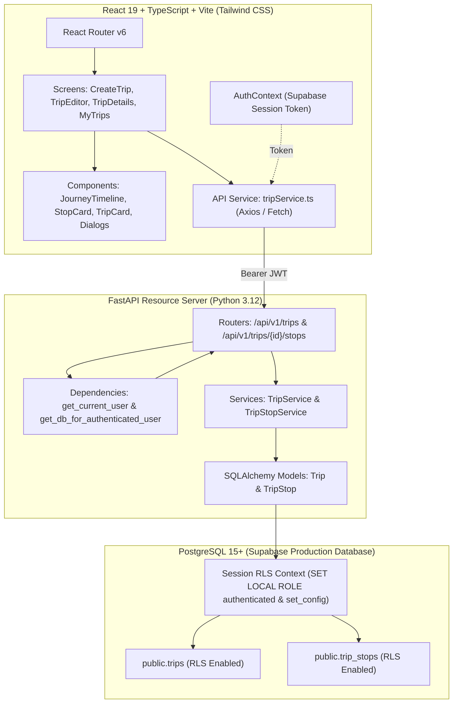
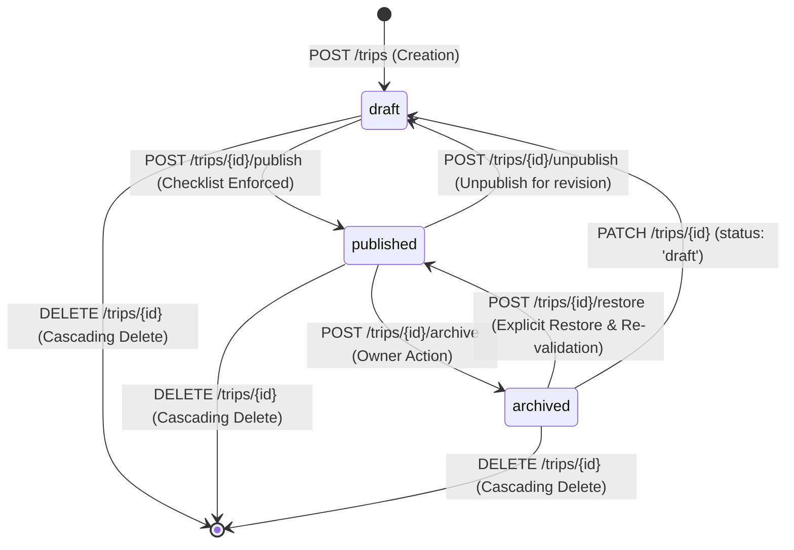
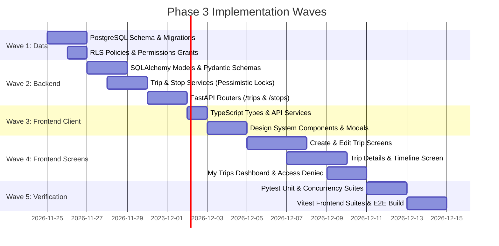

# MICHI (道) — Phase 3 Implementation Plan: Trip Management & Stop Engine

**Document Version:** 1.2 (Final Architecture Corrections Revision)  
**Status:** Approved for Review (Pre-Implementation Architecture Blueprint)  
**Date:** November 2026  
**Authors:** Lead Full-Stack Engineer & System Architect  
**Source of Truth:** [PRD.md](PRD.md), [ARCHITECTURE.md](ARCHITECTURE.md), [DATABASE.md](DATABASE.md), [API.md](API.md), [SECURITY.md](SECURITY.md), [USER_FLOWS.md](USER_FLOWS.md), [DEVELOPMENT_ROADMAP.md](DEVELOPMENT_ROADMAP.md), [STITCH_DESIGN_AUDIT.md](STITCH_DESIGN_AUDIT.md), [PHASE3_GAP_ANALYSIS.md](PHASE3_GAP_ANALYSIS.md)

---

## 1. Executive Summary & Phase Scope

Phase 3 transitions MICHI from foundational authentication and profile management into an active travel journey platform. A **Trip** is the primary core content entity in MICHI (PRD Module 3). Every trip represents a complete journey comprising an origin, optional intermediate waypoints (**Stops**), a final destination, timeline metadata, and strict public/private visibility boundaries.

### Core Objectives of Phase 3
1. **Trip & Stop Data Layer:** Design and execute the PostgreSQL relational schema, check constraints, foreign-key cascades, and Row-Level Security (RLS) policies for `public.trips` and `public.trip_stops`.
2. **Strict Lifecycle State Machine:** Formally implement and enforce dedicated lifecycle operations (`/publish`, `/archive`, `/restore`, `/unpublish`). Strip `status` from `TripUpdate`/`PATCH` to ensure publishing validation cannot be bypassed.
3. **Concurrent Stop Operations & Pessimistic Locking:** Implement parent-trip locking (`SELECT ... FOR UPDATE`) on all add, delete, and reorder operations. Evaluate and enforce collision-free sequence reordering on `(trip_id, order_index)`.
4. **Stop Ownership & Parent-Trip Binding:** Guarantee that every stop operation verifies ownership through the parent trip, rejects foreign stop IDs belonging to other trips, and enforces these rules identically in PostgreSQL RLS.
5. **PRD-Aligned Publishing Validation:** Enforce mandatory requirements (title, category, locations, valid dates, explicit visibility) without inventing requirements. Point-to-point journeys (0 stops) are fully supported per PRD Module 3.
6. **Harmonized Visibility Rule:** Standardize `visibility DEFAULT 'private'` at DB and schema layers, with UI pre-selecting "Private" while supporting explicit toggling to "Public".
7. **Frontend Trip Experience:** Build responsive, accessible UI screens following the Adventure Explorer design system for Trip Creation, Trip Editing, Stop Management, Timeline Visualization, and Flagship Trip Details.
8. **Database Compatibility Standards:** Rigorously distinguish local SQLite unit testing from native PostgreSQL RLS verification, ensuring SQLite emulation is never claimed as proof of PostgreSQL security.

---

## 2. Architectural Alignment & Technology Stack

Phase 3 builds directly upon the validated Phase 2 architecture:



- **Authentication Single Source of Truth:** Supabase Auth issues Bearer JWT tokens. FastAPI validates these tokens via project JWKS endpoints without issuing independent tokens.
- **Transaction-Scoped Database RLS:** FastAPI forwards verified claims (`request.jwt.claims`) to PostgreSQL using parameterized `set_config('request.jwt.claims', ..., true)` and `SET LOCAL ROLE authenticated` within the active transaction.
- **Design Tokens:** Exact values from `michi_design_system.md`:
  - Adventure Orange (`#FF7138`), Forest Green (`#246B4A`), Sky Blue (`#45B8E8`), Sunshine Yellow (`#FFD166`).
  - Light theme (`#F7F8F3` background, `#FFFFFF` surface) and Dark theme (`#141A18` background, `#202925` surface).
  - Typography: **Manrope** for headings, **Inter** for UI and body text.

---

## 3. Core Architectural Specifications

### 3.1 Lifecycle Enforcement & Mutation Isolation
1. **Isolation from `PATCH`:**
   - The field `status` is completely omitted from the `TripUpdate` schema.
   - Any attempt to pass `status` in `PATCH /api/v1/trips/{id}` is ignored or rejected. Status cannot be modified through ordinary metadata edits.
2. **Dedicated Lifecycle Operations:**
   - `POST /api/v1/trips/{id}/publish`: Transitions `draft` $\rightarrow$ `published` (or `archived` $\rightarrow$ `published`). Enforces the mandatory publishing checklist.
   - `POST /api/v1/trips/{id}/archive`: Transitions `published` $\rightarrow$ `archived`.
   - `POST /api/v1/trips/{id}/restore`: Transitions `archived` $\rightarrow$ `published` (re-validates publishing rules).
   - `POST /api/v1/trips/{id}/unpublish`: Transitions `published` $\rightarrow$ `draft`.
3. **State Machine Validation Matrix:**
   `TripService` strictly validates the current status before permitting any transition:
   - Archiving is permitted only from `published`. (Cannot archive a draft).
   - Restoring is permitted only from `archived`.
   - Unpublishing is permitted only from `published`.
   - Invalid transitions raise HTTP 422 (`INVALID_STATE_TRANSITION`).



---

### 3.2 Concurrent Stop Operations & Parent-Trip Locking
1. **Parent-Trip Pessimistic Lock (`SELECT ... FOR UPDATE`):**
   To prevent race conditions, duplicate indices, or gaps from concurrent requests on the same journey:
   - All stop modifications (`add_stop`, `delete_stop`, `reorder_stops`) begin by acquiring an exclusive row-level lock on the parent trip record:
     ```python
     parent_trip = db.query(TripModel).filter(TripModel.id == trip_id).with_for_update().first()
     ```
   - Validation and sequence updates occur strictly while holding this lock within a single database transaction.
2. **Collision-Free Ordering Strategy, Integer Bounds, and Non-Negative Constraint Compatibility:**
   - The database schema enforces `CONSTRAINT valid_order_index CHECK (order_index >= 0)` and `CONSTRAINT uq_trip_stops_trip_order UNIQUE (trip_id, order_index) DEFERRABLE INITIALLY DEFERRED`.
   - In PostgreSQL, **CHECK constraints cannot be deferred**. Temporary negative values (e.g. `order_index = -(order_index + 1)`) trigger immediate `check_violation (23514)` errors.
   - **Integer Type & Overflow Guard (32-bit INT):**
     - Retain `INT` (`order_index INT DEFAULT 0 NOT NULL`, $0 \le \text{order\_index} \le 2,147,483,647$).
     - Guard: `SAFE_MAX_ORDER_INDEX = 1_000_000_000`. If `current_max > SAFE_MAX_ORDER_INDEX`, reject immediately with HTTP 422 (`ORDER_INDEX_OVERFLOW`).
     - *Proof:* For $\text{current\_max} \le 10^9$, $\text{safe\_offset} \le 1,000,001,000$, and max shifted value is $\le 2,000,001,000 < 2,147,483,647$ (`INT4_MAX`). Overflow is impossible.
   - **Empty Stop List Handling:** Submitting `[]` for a 0-stop trip is an idempotent no-op returning `[]` (`HTTP 200 OK`). Submitting `[]` for a trip with $N > 0$ stops is rejected with HTTP 422 (`INCOMPLETE_STOP_SEQUENCE`).
   - **Non-Contiguous Index Normalization:** For existing stops with gaps (e.g. $0, 50, 9999$), shifting by $+safe\_offset$ is strictly injective, preserving uniqueness in the disjoint range. Phase 2 assigns dense contiguous target indices $0, \dots, N - 1$, normalizing the sequence automatically without collision.
   - To guarantee total non-negative compliance and zero duplicate key collisions during intermediate updates, `TripStopService.reorder_stops` executes the **Two-Phase Positive Disjoint Offset Algorithm**:
     - **Compute Safe Disjoint Offset:** `safe_offset = (SELECT COALESCE(MAX(order_index), 0) + 1000 FROM trip_stops WHERE trip_id = :trip_id)` ($safe\_offset \ge 1000$).
     - **Phase 1 (Shift to Disjoint Positive Range):**  
       `UPDATE trip_stops SET order_index = order_index + :safe_offset WHERE trip_id = :trip_id;`  
       All stops for the trip shift into $[safe\_offset, safe\_offset + current\_max]$ ($\ge 1000 > 0$), strictly satisfying `CHECK (order_index >= 0)` and maintaining mutual uniqueness.
     - **Phase 2 (Assign Final Sequential Indices):**  
       For each `(target_idx, stop_id)` in `enumerate(ordered_stop_ids)`:  
       `UPDATE trip_stops SET order_index = :target_idx WHERE id = :stop_id;`  
       Each stop updates to its target position in $[0, N - 1]$. Since $[0, N - 1]$ has zero overlap with $[safe\_offset, safe\_offset + current\_max]$, no intermediate assignment ever collides with an unshifted stop.
   - **Engine Separation & Test Portability:**
     - **PostgreSQL**: Production engine providing true MVCC row locks (`SELECT ... FOR UPDATE`) and `DEFERRABLE INITIALLY DEFERRED` uniqueness.
     - **SQLite**: Fast local unit test engine that does **not** support `SELECT ... FOR UPDATE` or `DEFERRABLE` unique constraints (relies on `BEGIN IMMEDIATE` file locking). The two-phase positive disjoint offset algorithm executes identically on both engines without syntax or integrity errors.
   - **Transaction Atomicity:** Entire reorder runs inside a single atomic transaction while holding the parent trip lock. Any failure rolls back the transaction completely, leaving original indices intact.

---

### 3.3 Stop Ownership & Parent-Trip Verification
1. **Application-Layer Binding:**
   - Every operation under `/api/v1/trips/{trip_id}/stops` must strictly verify that:
     1. The parent `trip_id` exists.
     2. The authenticated caller owns the parent trip (`trip.owner_id == current_user.id`).
     3. For any single-stop action (`PATCH`, `DELETE`), the target stop belongs **specifically** to `trip_id` (`stop.trip_id == trip.id`).
   - If a valid stop ID belonging to a different trip is supplied, the request is immediately rejected with HTTP `404 Not Found` (or `400 Bad Request`), preventing ID-switching attacks.
2. **Database-Layer RLS Binding:**
   - PostgreSQL RLS policies on `public.trip_stops` mirror this rule:
     ```sql
     USING (EXISTS (SELECT 1 FROM public.trips t WHERE t.id = trip_id AND t.owner_id = auth.uid()))
     ```
   - An immutable trigger prevents modifying `trip_id` on existing stop rows.

---

### 3.4 Publishing Validation Rules (PRD Source of Truth)
In strict accordance with PRD Modules 3 & 4:
- Mandatory publishing fields:
  1. `title`: Non-empty string, 3 to 150 characters.
  2. `category`: One of the 10 approved PRD categories.
  3. `starting_location`: Non-empty string (min 2 characters).
  4. `ending_location`: Non-empty string (min 2 characters).
  5. `start_date` and `end_date`: Both populated, and `end_date >= start_date`.
  6. `visibility`: Valid visibility setting (`public` or `private`).
- **Stop Requirement Clarification:** PRD Section 3.1 & Module 3 does **not** require intermediate stops to publish. Direct point-to-point journeys (0 intermediate stops) are completely valid. Intermediate stops are optional enhancements.
- Attempting to publish an incomplete journey returns HTTP `422 Unprocessable Entity` with code `PUBLISH_VALIDATION_FAILED`.

---

### 3.5 Visibility Selection & Default Harmonization
- **Database Layer:** `visibility trip_visibility DEFAULT 'private' NOT NULL`. Guaranteed privacy by default.
- **API Layer (Creation):** `TripCreate` defaults `visibility = TripVisibility.PRIVATE`.
- **API Layer (Publishing):** `POST /api/v1/trips/{id}/publish` accepts an optional payload: `{"visibility": "public" | "private"}`. If omitted, the trip's existing visibility is preserved.
- **Frontend Layer:** UI forms (`CreateTripScreen`, `PublishTripModal`) display the visibility selector with "Private" pre-selected by default, with a clear toggle to "Public".

---

### 3.6 Database Compatibility: PostgreSQL Production vs. SQLite Testing
1. **Production Engine:** **PostgreSQL 15+ (Supabase)** is the authoritative production and staging database engine. PostgreSQL is the ONLY database engine that enforces real native Row-Level Security (`ENABLE ROW LEVEL SECURITY`, `auth.uid()`, `SET LOCAL ROLE authenticated`, `set_config('request.jwt.claims', ...)`).
2. **Local Testing Engine:** **SQLite** is used strictly for fast, in-memory local unit tests.
3. **Emulation Boundary:**
   - SQLite tests use application-layer mocks and custom scalar triggers to emulate RLS behavior in memory.
   - **CRITICAL RULE:** Passing SQLite tests does NOT prove PostgreSQL RLS security.
   - Real PostgreSQL RLS verification requires executing the dedicated integration test suite (`tests/test_postgres_rls_integration.py`) against a real PostgreSQL container (`POSTGRES_TEST_DATABASE_URL`).
   - All test documentation, reports, and logs must clearly distinguish SQLite unit tests from PostgreSQL RLS tests.

---

## 4. Scope Boundaries: Phase 3 vs. Subsequent Phases

| Capability | Phase 3 (This Phase) | Phase 4 (Maps & Routing) | Phase 5 (Content & Media) | Phase 6 (Social) | Phase 7 (AI RAG) |
| :--- | :---: | :---: | :---: | :---: | :---: |
| **Trip CRUD & Status Lifecycle** | **Yes (Full)** | - | - | - | - |
| **Stops CRUD & Atomic Reordering**| **Yes (Full)** | - | - | - | - |
| **Chronological Timeline** | **Yes (DOM-based)**| - | - | - | - |
| **Coordinates (Lat/Lng)** | **Yes (Data fields)**| - | - | - | - |
| **Public/Private Privacy** | **Yes (Strict RLS)**| - | - | - | - |
| **Google Places Autocomplete**| *Deferred* | **Yes** | - | - | - |
| **Interactive Map & Polylines**| *Deferred* | **Yes** | - | - | - |
| **Google Directions Routing**| *Deferred* | **Yes** | - | - | - |
| **Photo/Video Uploads** | *Deferred (URLs only)*| - | **Yes (Cloudinary/S3)**| - | - |
| **Stop-Wise Experiences** | *Deferred* | - | **Yes** | - | - |
| **Travel Blogs & Stories** | *Deferred* | - | **Yes** | - | - |
| **Likes, Comments, Bookmarks**| *Deferred* | - | - | **Yes** | - |
| **AI RAG Vector Indexing** | *Deferred* | - | - | - | **Yes** |

---

## 5. Analysis of Missing UI Designs (Design Audit Resolution)

As documented in [docs/STITCH_DESIGN_AUDIT.md](STITCH_DESIGN_AUDIT.md), the following screens directly impact Phase 3 and must be built according to the design system specifications:

1. **Screen 13: Create Trip (`CreateTripScreen.tsx`):** Trip initiation wizard (title, 10 categories, start/end locations, dates, visibility toggle defaulting to private).
2. **Screen 14: Trip Editor (`TripEditorScreen.tsx`):** Master trip management hub (metadata editing, status management, stops controller).
3. **Screens 15 & 16: Add & Edit Journey Stops (`StopModal.tsx` / `StopEditor.tsx`):** Waypoint coordinates ($-90..90$, $-180..180$), dates, accommodation, notes.
4. **Screen 17: Journey Timeline (`JourneyTimeline.tsx`):** Vertical visual timeline clearly distinguishing:
   $$\text{Starting Location} \longrightarrow \text{Intermediate Stops} \longrightarrow \text{Final Destination}$$
5. **Screen 18: Trip Publishing Confirmation (`PublishTripModal.tsx`):** Pre-publish journey checklist and privacy toggle.
6. **Screen 19: Complete Trip Details (`TripDetailsScreen.tsx`):** Flagship journey view with branching logic for owners vs. public visitors.
7. **Screen 33: Unauthorized Access / 403 Forbidden (`AccessDeniedScreen.tsx`):** Friendly 403 Forbidden screen when an unauthorized visitor accesses a private journey.
8. **Screen 35: Confirmation Dialogs (`ConfirmModal.tsx`):** Accessible danger confirmation for deletions and archives.

---

## 6. Implementation Roadmap & Waves



---

## 7. Deliverables Index

The complete Phase 3 planning package includes:
1. **Implementation Plan:** `docs/PHASE3_IMPLEMENTATION_PLAN.md` (This document)
2. **Task Breakdown:** `docs/PHASE3_TASK_BREAKDOWN.md`
3. **Database Design:** `docs/PHASE3_DATABASE_DESIGN.md`
4. **API Design:** `docs/PHASE3_API_DESIGN.md`
5. **Test Plan:** `docs/PHASE3_TEST_PLAN.md`
6. **Gap Analysis & Correction Matrix:** `docs/PHASE3_GAP_ANALYSIS.md`
