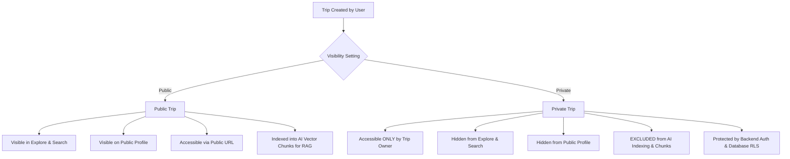

# Security, Privacy & Safety Architecture
## Project: MICHI (道) — The Adventure Explorer Travel Social Platform

**Version:** 1.0  
**Status:** Approved Specification (Aligned with PRD v1.0 Module 14 & Section 15)  
**Date:** November 2026  
**Document Owner:** Security & Backend Engineering Team  

---

## 1. Security & Privacy Philosophy

MICHI treats traveller privacy and physical safety as non-negotiable core requirements:
- **Two Distinct Visibility Levels**: Every trip and blog post is explicitly marked as either **Public** or **Private**.
- **Private Data Isolation**: Private content is accessible strictly by the owner, hidden from all public explore feeds, excluded from search, and **strictly excluded from the AI chatbot's vector index**.
- **Critical Security Acceptance Test**:
  > *"A user must never be able to retrieve another user's private trip, media, blog or experience through the frontend, API, database or AI chatbot."*

---

## 2. Trip Visibility Matrix (PRD Module 14)



| Scope | Public Visibility | Private Visibility |
| :--- | :---: | :---: |
| **Visible in Explore & Search** | Yes | **Never** |
| **Visible on Public Traveller Profile** | Yes | **Never** |
| **Direct URL Access** | Publicly accessible | **403 Forbidden for non-owners** |
| **AI Profile Chatbot Indexing** | Yes (Chunked & Vectorized) | **Strictly Excluded** |
| **Database Access Enforcement** | Open via RLS | **Protected via `owner_id = auth.uid()`** |
| **Media URL Security** | Public CDN delivery | **Protected / Signed Access** |

---

## 3. Database Row Level Security (RLS) Enforcement

RLS is enabled across all 14 database tables in PostgreSQL.

```sql
-- 1. Enable RLS on all sensitive tables
ALTER TABLE public.trips ENABLE ROW LEVEL SECURITY;
ALTER TABLE public.trip_stops ENABLE ROW LEVEL SECURITY;
ALTER TABLE public.experiences ENABLE ROW LEVEL SECURITY;
ALTER TABLE public.blog_posts ENABLE ROW LEVEL SECURITY;
ALTER TABLE public.media_assets ENABLE ROW LEVEL SECURITY;
ALTER TABLE public.ai_content_chunks ENABLE ROW LEVEL SECURITY;

-- 2. Trips: Public vs Private Isolation
CREATE POLICY "Public trips viewable by anyone" 
ON public.trips FOR SELECT 
USING (visibility = 'public' AND status = 'published');

CREATE POLICY "Owners can view, insert, update and delete own trips" 
ON public.trips FOR ALL 
USING (auth.uid() = owner_id);

-- 3. AI Vector Chunks: Absolute Exclusion of Private Data
CREATE POLICY "Only public content chunks can be queried" 
ON public.ai_content_chunks FOR SELECT 
USING (visibility = 'public');

-- 4. Media Assets: Inherit Trip Protection
CREATE POLICY "Public media is viewable by all"
ON public.media_assets FOR SELECT
USING (
    EXISTS (
        SELECT 1 FROM public.trips t 
        WHERE t.id = trip_id AND t.visibility = 'public'
    )
    OR user_id = auth.uid()
);
```

---

## 4. AI Traveller Chatbot Privacy Safeguards (Module 12)

The AI chatbot operates under strict server-side retrieval boundaries:

1. **Server-Side Enforcement**: Profile filtering (`user_id = traveller_id`) and visibility filtering (`visibility = 'public'`) are applied strictly in the FastAPI SQL/vector query. The frontend is never trusted with filtering private data.
2. **Zero Cross-Traveller Retrieval**: Questions addressed to `@travellerA` can never query or return chunks belonging to `@travellerB`.
3. **Abstention Protocol**: If requested details (such as budget, accommodation, or specific destinations) are not present in the traveller's public logs, the AI chatbot is instructed to cleanly state that information is unavailable rather than guessing or hallucinating.
4. **Owner Control**: Profile owners can toggle their AI chatbot off at any time (`is_ai_chatbot_enabled = false`).

---

## 5. Media Security & Safe Storage

- **Storage Separation**: Media files are stored in dedicated cloud object storage (Cloudinary or Supabase Storage). PostgreSQL stores only metadata and URLs.
- **Upload Validation**: File extensions, MIME types, and file size limits (max 15MB for photographs, max 200MB for video) are validated both client-side and server-side.
- **Protected Access**: Private trip media utilizes temporary signed URLs with 1-hour expiry, preventing unrestricted public link sharing.

---

## 6. Social Safety, Reporting & Account Deletion

- **Content Reporting (FR-SOC-09)**: Users can report inappropriate content or abusive behavior into the `reports` table.
- **User Blocking (FR-SOC-10)**: Blocking a user hides their comments and prevents them from viewing the blocker's profile.
- **Account Deletion (FR-AUTH-09)**: Deleting an account initiates a cascading purge across all associated trips, stops, media, blogs, comments, and AI vector chunks.

---

## 7. Authentication & Identity Security (Phase 2 Unified Model)

- **Single Source of Truth**: User authentication, registration, password hashing, and session management are unified under **Supabase Auth**. FastAPI functions strictly as an authorized resource server and never stores raw or hashed passwords.
- **Asymmetric Token Verification**: FastAPI validates incoming Bearer JWTs using project JWKS endpoints (`SUPABASE_JWKS_URL`). Every request verifies signature, expiration (`exp`), and audience (`aud = 'authenticated'`).
- **No Token Leakage**: Password recovery links and OTP codes are dispatched exclusively via encrypted email delivery. API responses never disclose password reset tokens (`dev_reset_token` is forbidden).
- **Session Revocation**: Logout operations terminate sessions via `supabase.auth.signOut()`, triggering server-side session invalidation.

---

## 8. Cross-Reference Links

- Product Requirements Document: [PRD.md](PRD.md)
- Database RLS Implementation: [DATABASE.md](DATABASE.md)
- Testing & Privacy Verification: [TESTING.md](TESTING.md)
