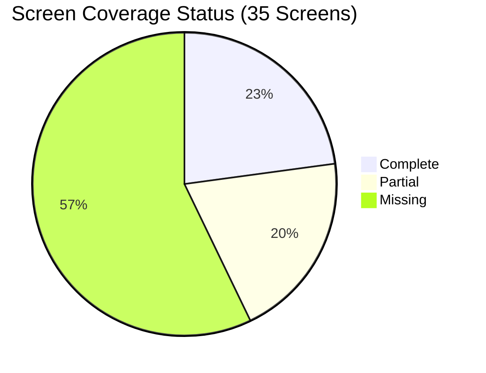

# Google Stitch Design System & Screen Audit
## Project: MICHI (道) — The Adventure Explorer Travel Social Platform

**Version:** 1.0  
**Audit Date:** November 2026  
**Auditor:** Architecture & UI/UX Engineering  
**Source of Truth:** [PRD.md](PRD.md) (PRD v1.0)  
**Export Location:** [stitch_michi_travel_design_system/](file:///d:/travel%20social%20medio%20web/stitch_michi_travel_design_system)  

---

## 1. Executive Summary

This audit assesses the exported Google Stitch design assets against the official **MICHI Product Requirements Document (PRD v1.0)**. 

### Key Audit Findings
1. **Design System High-Fidelity Baseline**: The export contains a complete, accessible, production-grade design system in [michi_design_system.md](file:///d:/travel%20social%20medio%20web/stitch_michi_travel_design_system/michi_design_system.md) and [michi_brand_identity_design_system/code.html](file:///d:/travel%20social%20medio%20web/stitch_michi_travel_design_system/michi_brand_identity_design_system/code.html). It defines exact Tailwind CSS tokens, colors, typography scales, spacing, border radii, and motion curves.
2. **100% Light & Dark Theme Coverage on Exported Files**: Every exported HTML screen includes fully implemented Light (`#F7F8F3` background, `#FFFFFF` surface) and Dark (`#141A18` background, `#202925` surface) mode classes with interactive JavaScript theme toggles.
3. **Core Authentication & Discovery Flows are Complete**: Registration, Login, Forgot Password, Email Verification, Landing Page (Desktop, Tablet, Mobile), Explore, and AI Traveller Chatbot are fully realized with interactive states.
4. **Significant Core Trip Creation & Management Gaps**: Out of the 35 screens specified in PRD Section 7, **8 screens are Complete**, **7 screens are Partially realized**, and **20 screens are Missing**—most critically the Complete Trip Details page (Screen 19), Trip Creation & Stop Editor (Screens 13–16), Photo Manager (Screen 21), and Blog/Vlog Studios (Screens 22–24).

---

## 2. Exported Directory Structure & File Inventory

The exported folder [stitch_michi_travel_design_system/](file:///d:/travel%20social%20medio%20web/stitch_michi_travel_design_system) contains 14 files across 13 directories:

```text
stitch_michi_travel_design_system/
│
├── michi_design_system.md                         # 9.9 KB — Design System Specs & Tokens
├── michi_brand_identity_design_system/code.html   # 61.2 KB — Master Brand Identity & Component Library
│
├── michi_landing_page_desktop/code.html           # 70.6 KB — Landing Page (Desktop 1280px+)
├── michi_landing_page_tablet/code.html            # 32.1 KB — Landing Page (Tablet 768px - 1024px)
├── michi_landing_page_mobile/code.html            # 20.7 KB — Landing Page (Mobile 390px)
│
├── 1._michi_login/code.html                       # 18.6 KB — Login Screen (with Error Preview)
├── 2._michi_registration/code.html                # 16.7 KB — Registration Screen
├── 3._michi_forgot_password/code.html             # 11.7 KB — Password Reset (with Success Preview)
├── 4._michi_email_verification/code.html          # 12.7 KB — Email OTP / Magic Link Verification
│
├── 5._michi_explore/code.html                     # 45.1 KB — Explore Journeys & Search (with Empty State)
├── 6._michi_home_feed/code.html                   # 28.5 KB — Authenticated Home Feed & Summary
├── 7._michi_public_traveller_profile/code.html    # 24.4 KB — Public Profile View (@meera.frames)
├── 8._michi_my_profile_owner/code.html            # 18.0 KB — Authenticated Profile Owner View (@aarav.rides)
└── 9._michi_ask_ai_about_this_traveller/code.html # 17.4 KB — AI Profile Chatbot Modal / Drawer
```

---

## 3. Screen Inventory vs. PRD v1.0 (35 Application Screens)

The table below audits all 35 application screens defined in **PRD Section 7**:

| Screen ID & Name | Purpose in PRD | Available Stitch Files | Key Components Present | Responsive Variants | Theme Support | PRD Module | Status |
| :--- | :--- | :--- | :--- | :---: | :---: | :---: | :---: |
| **01. Landing Page** | Public front door, value proposition, featured routes | `michi_landing_page_desktop`<br/>`michi_landing_page_tablet`<br/>`michi_landing_page_mobile` | Hero section, interactive map preview, journey cards, social proof, footer | Desktop, Tablet, Mobile | Light & Dark | Module 11 | **Complete** |
| **02. Explore Page** | Public discovery, search, filtering | `5._michi_explore/code.html` | Search bar, suggested tags, category chips, 5 filter selects, featured & recent grids | Desktop (Reflows to Mobile) | Light & Dark | Module 11 | **Complete** |
| **03. Public Trip Details** | Interactive map & timeline view for visitors | *None* | *None* | None | None | Modules 3, 4, 5 | **Missing** |
| **04. Public Traveller Profile** | Public identity, stats, published journey showcases | `7._michi_public_traveller_profile/code.html` | Hero banner, avatar, bio, stats (trips, followers), Ask AI button, tabs (Overview, Trips, Blogs, Photos, Videos) | Desktop (Reflows) | Light & Dark | Module 2 | **Complete** |
| **05. Public Blog Reading Page** | Long-form editorial travelogue reader | *None* | *None* | None | None | Module 7 | **Missing** |
| **06. Login** | User sign-in & session creation | `1._michi_login/code.html` | Email/password inputs, Google OAuth, error preview toggle, remember me | Desktop Split View | Light & Dark | Module 1 | **Complete** |
| **07. Registration** | Account creation & terms consent | `2._michi_registration/code.html` | Full name, username, email, password, Google OAuth, terms checkbox | Desktop Split View | Light & Dark | Module 1 | **Complete** |
| **08. Forgot Password** | Password reset request | `3._michi_forgot_password/code.html` | Email input, reset instructions, back-to-login, success state toggle | Desktop Split View | Light & Dark | Module 1 | **Complete** |
| **09. Email Verification** | Email OTP & link verification | `4._michi_email_verification/code.html` | OTP code inputs, resend timer, change email link | Desktop Centered | Light & Dark | Module 1 | **Complete** |
| **10. AI Traveller Chatbot** | Conversational Q&A on a traveller's public logs | `9._michi_ask_ai_about_this_traveller/code.html` | Chat header, conversation bubbles, source citations, suggested query pills, input field, loading toggle | Desktop / Drawer Modal | Light & Dark | Module 12 | **Complete** |
| **11. Home Feed** | Authenticated stream of followed journeys | `6._michi_home_feed/code.html` | 3-column layout: user summary sidebar, feed journey cards, create trip banner, trending sidebar | Desktop / Mobile Drawer | Light & Dark | Modules 2, 10 | **Complete** |
| **12. User Dashboard** | Traveler's personal analytics & trip management hub | *Partially in `6._michi_home_feed` & `8._michi_my_profile_owner`* | Published/draft counters, quick resume links | Partial | Light & Dark | Modules 2, 3 | **Partial** |
| **13. Create Trip** | Initiation modal/page for a new journey | *None* (Trigger button exists in navbar/feed) | *None* | None | None | Module 3 | **Missing** |
| **14. Trip Editor** | Metadata editing (dates, budget, privacy) | *None* | *None* | None | None | Module 3 | **Missing** |
| **15. Add Journey Stops** | Waypoint search & coordinate entry | *None* | *None* | None | None | Module 4 | **Missing** |
| **16. Stop Details Editor** | Accommodation, activities & notes editor | *None* | *None* | None | None | Module 4 | **Missing** |
| **17. Journey Timeline** | Chronological timeline view (*Start $\rightarrow$ Stops $\rightarrow$ End*) | *Partially represented in Journey Cards* | Ordered stop markers, distance badges | Partial | Light & Dark | Module 4 | **Partial** |
| **18. Trip Publishing** | Final pre-publish review & visibility toggle | *None* | *None* | None | None | Module 3 | **Missing** |
| **19. Complete Trip Details** | Authenticated flagship trip management view | *None* | *None* | None | None | Modules 3, 4, 5 | **Missing** |
| **20. Add Experience** | Field highlight & moment logger | *None* | *None* | None | None | Module 6 | **Missing** |
| **21. Photo Manager** | Batch photo upload, EXIF review, captions | *None* | *None* | None | None | Module 8 | **Missing** |
| **22. Blog Editor** | Rich-text markdown travelogue studio | *None* | *None* | None | None | Module 7 | **Missing** |
| **23. Vlog Uploader** | Video upload and metadata manager | *None* | *None* | None | None | Module 9 | **Missing** |
| **24. Vlog Gallery** | Trip video player and gallery view | *Tab in `7._michi_public_traveller_profile`* | Videos tab placeholder | Partial | Light & Dark | Module 9 | **Partial** |
| **25. Saved Trips** | Bookmarked journeys library | *Nav link in `6._michi_home_feed`* | *None* | None | None | Module 10 | **Partial** |
| **26. Notifications** | Notification center and activity list | *Header bell icon in `6._michi_home_feed`* | Icon only; no dropdown/page | None | None | Module 13 | **Partial** |
| **27. Edit Profile** | Profile picture, cover, bio, and social links editor | `8._michi_my_profile_owner/code.html` | "Edit Profile" button present; modal/form missing | Partial | Light & Dark | Module 2 | **Partial** |
| **28. Account Settings** | Email, password, account deletion controls | *None* | *None* | None | None | Module 1 | **Missing** |
| **29. Privacy Settings** | AI chatbot toggle, profile visibility, location fuzzing | *None* | *None* | None | None | Modules 12, 14 | **Missing** |
| **30. Loading States** | Shimmers, spinners, skeleton screens | *Toggles in `9._michi_ask_ai_about_this_traveller`* | `progress_activity` spinner | Partial | Light & Dark | Shared System | **Partial** |
| **31. Empty States** | Zero-state displays (no trips, no search results) | *Toggle in `5._michi_explore/code.html`* | Empty search results container | Partial | Light & Dark | Shared System | **Partial** |
| **32. Error States** | Form validation & server error alerts | *Toggle in `1._michi_login/code.html`* | Error alert box with icon | Partial | Light & Dark | Shared System | **Partial** |
| **33. Unauthorized Access** | 403 Forbidden screen (User Journey E) | *None* | *None* | None | None | Module 14 | **Missing** |
| **34. Upload Progress** | Progress bar for large photo/video uploads | *None* | *None* | None | None | Modules 8, 9 | **Missing** |
| **35. Confirmation Dialogs**| Delete trip / archive confirmations | *None* | *None* | None | None | Shared System | **Missing** |

---

## 4. Screen Coverage Summary



- **Complete Screens**: **8** (23%)
- **Partially Represented Screens**: **7** (20%)
- **Missing Screens**: **20** (57%)
- **Bonus Master Design Asset**: `michi_brand_identity_design_system` + `michi_design_system.md` (Provides complete component styles for building the missing screens).

---

## 5. Extracted Design System Specifications

The exported design system is exceptionally well-specified in [michi_design_system.md](file:///d:/travel%20social%20medio%20web/stitch_michi_travel_design_system/michi_design_system.md).

### 5.1 Color Tokens
- **Brand Colors**:
  - `adventure-orange`: `#FF7138` (on-adventure-orange: `#141A18`)
  - `forest-green`: `#246B4A` (on-forest-green: `#FFFFFF`)
  - `sky-blue`: `#45B8E8` (on-sky-blue: `#001E2B`)
  - `sunshine-yellow`: `#FFD166` (on-sunshine-yellow: `#251A00`)
- **Light Theme**:
  - `background`: `#F7F8F3` (on-background: `#141A18`)
  - `surface`: `#FFFFFF` (on-surface: `#141A18`)
  - `surface-container`: `#ECF2EE`
  - `surface-container-high`: `#DEE4E0`
  - `on-surface-variant`: `#424846`
  - `primary`: `#246B4A` (on-primary: `#FFFFFF`)
  - `outline-variant`: `#C2C8C4`
  - `error`: `#BA1A1A`
- **Dark Theme**:
  - `background`: `#141A18` (on-background: `#ECF2EE`)
  - `surface`: `#202925` (on-surface: `#ECF2EE`)
  - `surface-container`: `#2C322F`
  - `surface-container-high`: `#38403C`
  - `on-surface-variant`: `#C2C8C4`
  - `primary`: `#8FD6AD` (on-primary: `#003822`)
  - `secondary`: `#FF8C60`
  - `outline-variant`: `#424846`
  - `error`: `#FFB4AB`

### 5.2 Typography System
- **Headings Font**: **Manrope** (`font-display`, `font-headline`, `font-title`).
- **Body & UI Font**: **Inter** (`font-body`, `font-label`).
- **Scale**:
  - `display-lg`: `56px` / `62px` (Mobile: `32px` / `38px`)
  - `display-md`: `44px` / `50px` (Mobile: `28px` / `34px`)
  - `headline-lg`: `36px` / `44px` (Mobile: `24px` / `30px`)
  - `headline-md`: `24px` / `32px`
  - `title-lg`: `20px` / `28px`
  - `title-md`: `16px` / `24px`
  - `body-lg`: `16px` / `26px`
  - `body-md`: `14px` / `22px`
  - `label-lg`: `14px` / `20px`
  - `label-md`: `12px` / `16px`
  - `label-sm`: `11px` / `14px`

### 5.3 Iconography & Micro-interactions
- **Icon Library**: Google **Material Symbols Outlined** (consistent with the Google Stitch toolchain).
- **Motion Durations**: `state-change` (120ms ease-out), `surface-enter` (240ms cubic-bezier), `surface-exit` (160ms cubic-bezier).

---

## 6. PRD Alignment & Gap Analysis

| PRD Module / Area | Stitch Export Coverage | Critical Gaps Identified |
| :--- | :--- | :--- |
| **Module 1: Auth & Account** | Login, Register, Forgot Password, Email Verification complete. | Account Settings (FR-AUTH-08) and Account Deletion (FR-AUTH-09) screens are missing. |
| **Module 2: Traveller Profiles** | Public profile (`7._michi_public_traveller_profile`) and Owner view (`8._michi_my_profile_owner`) complete. | Edit Profile modal form (FR-PRO-02) is missing. |
| **Module 3: Trip Management** | Trip cards in Explore and Feed show route, dates, and owner info. | **CRITICAL GAP**: No screens exist for Create Trip (FR-TRIP-01), Trip Editor (FR-TRIP-02), or Complete Trip Details (Screen 19). |
| **Module 4: Stops & Timeline** | Route strings shown (*"Manali → Rohtang → Kaza"*). | **CRITICAL GAP**: No screen exists for Adding Stops (FR-STOP-01), Editing Stops (FR-STOP-02), or Reordering (FR-STOP-04). |
| **Module 5: Maps & Routing** | Map teaser preview on Landing Page. | Full interactive Google Maps canvas synchronized with the journey timeline is not yet exported. |
| **Module 6: Experiences** | Experiences mentioned in cards. | Add Experience form (FR-EXP-01) is missing. |
| **Module 7: Blogs** | Blog cards present on Explore & Profile. | Blog reading page (Screen 5) and Blog editor (Screen 22) are missing. |
| **Module 8: Photography** | Responsive photo grids on profiles. | Photo upload manager with captions and EXIF inspector (FR-PHOTO-01) is missing. |
| **Module 9: Vlogs & Videos** | Videos tab present on profiles. | Dedicated vlog upload and player screen (FR-VIDEO-01) is missing. |
| **Module 10: Social** | Follow buttons, like/comment count badges present. | Threaded comment modal and Saved Trips standalone page (Screen 25) are missing. |
| **Module 11: Explore & Discovery** | Comprehensive explore page with filters, search, and category chips. | None. This module has the strongest coverage in the export. |
| **Module 12: AI Chatbot** | "Ask AI About This Traveller" drawer complete with citations and suggested questions. | None. Excellent alignment with PRD Module 12. |
| **Module 13: Notifications** | Bell icon present in header. | Notification dropdown / center page (Screen 26) is missing. |
| **Module 14: Privacy & Safety** | Public tag badges, login error alerts. | Unauthorized Access screen (Screen 33) and Privacy Settings (Screen 29) are missing. |

---

## 7. Recommended Next Steps

1. **Retain Stitch Exports As Canonical References**: Keep all 13 exported directories untouched under [stitch_michi_travel_design_system/](file:///d:/travel%20social%20medio%20web/stitch_michi_travel_design_system).
2. **Update Core Documentation**: Update [UI_UX_GUIDELINES.md](UI_UX_GUIDELINES.md), [DESIGN_SYSTEM.md](DESIGN_SYSTEM.md), and [USER_FLOWS.md](USER_FLOWS.md) to integrate the audited tokens, components, and screen states.
3. **Phase 1 UI Design Prioritization**: Focus Google Stitch design efforts on the top 5 missing high-priority screens:
   - **Screen 19**: Complete Trip Details (with Google Maps & Synchronized Timeline).
   - **Screen 13/15**: Create Trip & Add Journey Stops Flow.
   - **Screen 5**: Public Blog Reading Page.
   - **Screen 22**: Blog Editor Studio.
   - **Screen 33**: Unauthorized Access (403 Forbidden for User Journey E).
4. **Preserve Boundary**: Keep this task focused on audit and documentation; proceed to frontend implementation only after design sign-off.
