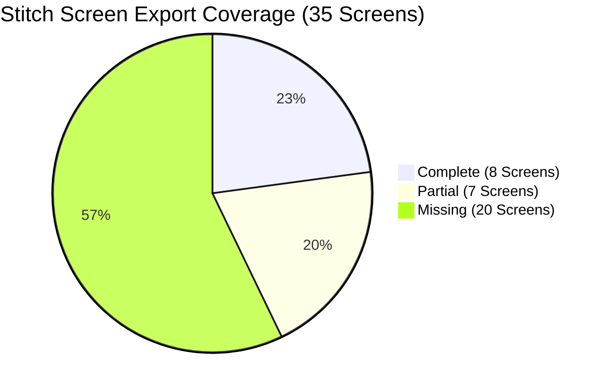

# UI/UX Guidelines & Interaction Design
## Project: MICHI (道) — The Adventure Explorer Travel Social Platform

**Version:** 1.0  
**Status:** Approved Specification (Audited with Google Stitch Exports)  
**Date:** November 2026  
**Document Owner:** UI/UX Design Team (Google Stitch)  
**Audit Reference:** [STITCH_DESIGN_AUDIT.md](STITCH_DESIGN_AUDIT.md)  

---

## 1. Design Direction: Adventure Explorer

The design direction for **MICHI** is **Adventure Explorer**, evoking the thrill of discovery, the natural elements of mountain and forest trails, and the quiet dignity of a personal field journal.

The user interface must:
1. Treat the **complete journey** as the central content unit rather than fragmented snapshots.
2. Provide immediate visual clarity: **Starting location → Intermediate stops → Final destination**.
3. Offer equal visual excellence across both **Light theme** (`#F7F8F3` background, `#FFFFFF` surface) and **Dark theme** (`#141A18` background, `#202925` surface).
4. Remain responsive across **Desktop, Tablet, and Mobile**.

---

## 2. The 35 Main Application Screens & Stitch Export Status

Following the Stitch design audit against PRD Section 7, the 35 screens are mapped below with their export status and file references:

### 2.1 Public Screens (1–10)

| Screen ID & Name | Stitch Export Path | Status | Exported Components & Notes |
| :--- | :--- | :---: | :--- |
| **01. Landing Page** | [stitch/.../michi_landing_page_desktop](file:///d:/travel%20social%20medio%20web/stitch_michi_travel_design_system/michi_landing_page_desktop) [michi_landing_page_tablet](file:///d:/travel%20social%20medio%20web/stitch_michi_travel_design_system/michi_landing_page_tablet) [michi_landing_page_mobile](file:///d:/travel%20social%20medio%20web/stitch_michi_travel_design_system/michi_landing_page_mobile) | **Complete** | Responsive hero with route map teaser, featured journey cards, community testimonials, and responsive navigation drawer. |
| **02. Explore Page** | [stitch/.../5._michi_explore](file:///d:/travel%20social%20medio%20web/stitch_michi_travel_design_system/5._michi_explore) | **Complete** | Search bar with suggested tags, category filter chips, multi-select dropdowns, journey cards with route tags, and empty state preview. |
| **03. Public Trip Details** | *Not yet exported* | **Missing** | High priority for Stitch Phase 1. |
| **04. Public Traveller Profile**| [stitch/.../7._michi_public_traveller_profile](file:///d:/travel%20social%20medio%20web/stitch_michi_travel_design_system/7._michi_public_traveller_profile) | **Complete** | Full profile view (`@meera.frames`), bio, travel stats, "Ask AI" trigger button, and 5 tabs (Overview, Trips, Blogs, Photos, Videos). |
| **05. Public Blog Reading Page**| *Not yet exported* | **Missing** | Editorial typography reader with embedded stop cards. |
| **06. Login** | [stitch/.../1._michi_login](file:///d:/travel%20social%20medio%20web/stitch_michi_travel_design_system/1._michi_login) | **Complete** | Split desktop layout, email/password inputs, Google OAuth, password reveal, error alert preview toggle. |
| **07. Registration** | [stitch/.../2._michi_registration](file:///d:/travel%20social%20medio%20web/stitch_michi_travel_design_system/2._michi_registration) | **Complete** | Split desktop layout, full name, username, email, password, Google OAuth, terms checkbox. |
| **08. Forgot Password** | [stitch/.../3._michi_forgot_password](file:///d:/travel%20social%20medio%20web/stitch_michi_travel_design_system/3._michi_forgot_password) | **Complete** | Email input, reset instructions, success state preview toggle, back to login link. |
| **09. Email Verification** | [stitch/.../4._michi_email_verification](file:///d:/travel%20social%20medio%20web/stitch_michi_travel_design_system/4._michi_email_verification) | **Complete** | 6-digit OTP code inputs, resend countdown timer, change email link. |
| **10. AI Traveller Chatbot** | [stitch/.../9._michi_ask_ai_about_this_traveller](file:///d:/travel%20social%20medio%20web/stitch_michi_travel_design_system/9._michi_ask_ai_about_this_traveller) | **Complete** | Conversational modal/drawer, suggested questions pills, grounded response bubbles with clickable trip/blog citations, loading indicator toggle. |

### 2.2 Authenticated Screens (11–29)

| Screen ID & Name | Stitch Export Path | Status | Exported Components & Notes |
| :--- | :--- | :---: | :--- |
| **11. Home Feed** | [stitch/.../6._michi_home_feed](file:///d:/travel%20social%20medio%20web/stitch_michi_travel_design_system/6._michi_home_feed) | **Complete** | 3-column dashboard: left profile summary, center feed with trip cards & create trip banner, right trending sidebar. |
| **12. User Dashboard** | Partially in `6._michi_home_feed` & `8._michi_my_profile_owner` | **Partial** | Quick resume drafts card and stats present; standalone dashboard pending. |
| **13. Create Trip** | *Not yet exported* | **Missing** | Trigger button exists in header and feed; full wizard screen pending. |
| **14. Trip Editor** | *Not yet exported* | **Missing** | Trip metadata and cover photo editor. |
| **15. Add Journey Stops** | *Not yet exported* | **Missing** | Stop search and waypoint logging modal. |
| **16. Stop Details Editor** | *Not yet exported* | **Missing** | Accommodation, activity notes, and date editor. |
| **17. Journey Timeline** | Embedded inside Journey Cards | **Partial** | Route strings (*"Start → Stops → End"*) present; full timeline view pending. |
| **18. Trip Publishing** | *Not yet exported* | **Missing** | Visibility and review modal. |
| **19. Complete Trip Details** | *Not yet exported* | **Missing** | **CRITICAL MVP SCREEN**: Integrated Google Map + Timeline split. |
| **20. Add Experience** | *Not yet exported* | **Missing** | Moment and field note logger. |
| **21. Photo Manager** | *Not yet exported* | **Missing** | Batch photo upload, captions, and EXIF viewer. |
| **22. Blog Editor** | *Not yet exported* | **Missing** | Rich-text markdown travelogue editor. |
| **23. Vlog Uploader** | *Not yet exported* | **Missing** | Video uploader and metadata form. |
| **24. Vlog Gallery** | Tab in `7._michi_public_traveller_profile` | **Partial** | Video player and gallery view. |
| **25. Saved Trips** | Nav link in `6._michi_home_feed` | **Partial** | Dedicated saved journeys library screen pending. |
| **26. Notifications** | Bell icon in header | **Partial** | Standalone notification dropdown / center pending. |
| **27. Edit Profile** | [stitch/.../8._michi_my_profile_owner](file:///d:/travel%20social%20medio%20web/stitch_michi_travel_design_system/8._michi_my_profile_owner) | **Partial** | Profile owner view complete with "Edit Profile" button; edit modal pending. |
| **28. Account Settings** | *Not yet exported* | **Missing** | Email, password, and account deletion screen. |
| **29. Privacy Settings** | *Not yet exported* | **Missing** | AI chatbot toggle, profile visibility, location fuzzing controls. |

### 2.3 Shared System Screens (30–35)

| Screen ID & Name | Stitch Export Path | Status | Exported Components & Notes |
| :--- | :--- | :---: | :--- |
| **30. Loading States** | Toggles in `9._michi_ask_ai_about_this_traveller` | **Partial** | Animated spinner and skeleton bubble present. |
| **31. Empty States** | Toggle in `5._michi_explore` | **Partial** | Empty search results container present. |
| **32. Error States** | Toggle in `1._michi_login` | **Partial** | Form error alert with icon present. |
| **33. Unauthorized Access** | *Not yet exported* | **Missing** | 403 Forbidden screen required for User Journey E. |
| **34. Upload Progress** | *Not yet exported* | **Missing** | Progress bar for large media uploads. |
| **35. Confirmation Dialogs**| *Not yet exported* | **Missing** | Delete trip / archive modal dialogs. |

---

## 3. The 5 Most Important UX Experiences (PRD Section 12)

### 3.1 Complete Trip Details Page (Screen 19) — *Design Needed*
- **Layout**: Side-by-side split screen (or map-timeline toggle on mobile).
- **Google Maps Canvas**: High-contrast vector styling displaying origin pin, intermediate numbered stops, and destination pin.
- **Timeline**: Vertical chronological sequence showing transit modes, duration, and stop-wise photos.

### 3.2 Trip Creation Flow (Screens 13–18) — *Design Needed*
- Progressive 5-step wizard:
  1. Metadata (Title, dates, category, cover image, public/private).
  2. Starting and Ending location lookup via Google Places autocomplete.
  3. Intermediate stops with draggable reordering.
  4. Stop-wise experiences and photo uploads.
  5. Route preview and publication.

### 3.3 Interactive Journey Map (Screen 17 / Module 5) — *Partially Designed*
- Google Maps Platform integration.
- Clear differentiation between **verified road routes** (solid line) and **unverified connecting lines** (dashed line).

### 3.4 Traveller Profile (Screens 4 & 8) — *Exported & Complete*
- **Public View** ([7._michi_public_traveller_profile](file:///d:/travel%20social%20medio%20web/stitch_michi_travel_design_system/7._michi_public_traveller_profile)): Cover photo, avatar, bio, location, followers/following, "Ask AI" button, and 5 content tabs.
- **Owner View** ([8._michi_my_profile_owner](file:///d:/travel%20social%20medio%20web/stitch_michi_travel_design_system/8._michi_my_profile_owner)): Displays draft trip badges, "Edit Profile" button, and quick resume editing links.

### 3.5 AI Traveller Chatbot (Screen 10) — *Exported & Complete*
- Complete in [9._michi_ask_ai_about_this_traveller](file:///d:/travel%20social%20medio%20web/stitch_michi_travel_design_system/9._michi_ask_ai_about_this_traveller).
- Features suggested question pills (e.g. *"Which places has this traveller visited?"*, *"Where did they stay?"*).
- Grounded answer bubble with source citations linking directly to public trips and blogs.

---

## 4. Design Standards & Tokenization in Code

All exported Stitch HTML designs adhere to standardized HTML markup and data attributes:
- **Text Tokens**: `data-design-text-token="display-lg"`, `headline-md`, `title-lg`, `body-md`, `label-sm`.
- **Component IDs**: `data-component-id="button-accent"`, `input-field-icon`, `card-interactive`.
- **Theme Switching**: `#theme-toggle` button toggling the `dark` class on `document.documentElement`.
- **State Toggles**: Included `#demo-error-btn`, `#empty-toggle-btn`, and `#loading-toggle` buttons for interactive state previews.

---

## 5. Cross-Reference Links

- Design System Specifications: [DESIGN_SYSTEM.md](DESIGN_SYSTEM.md)
- Complete Screen Audit: [STITCH_DESIGN_AUDIT.md](STITCH_DESIGN_AUDIT.md)
- Primary User Journeys: [USER_FLOWS.md](USER_FLOWS.md)
- Product Requirements Document: [PRD.md](PRD.md)
