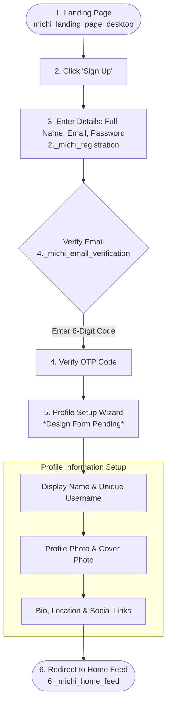
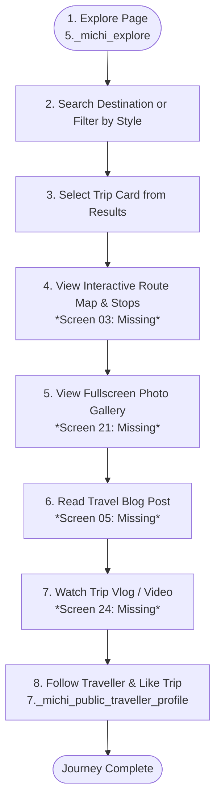
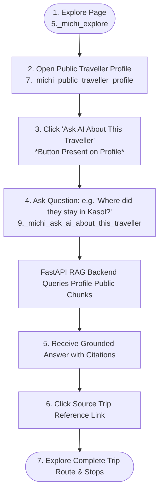
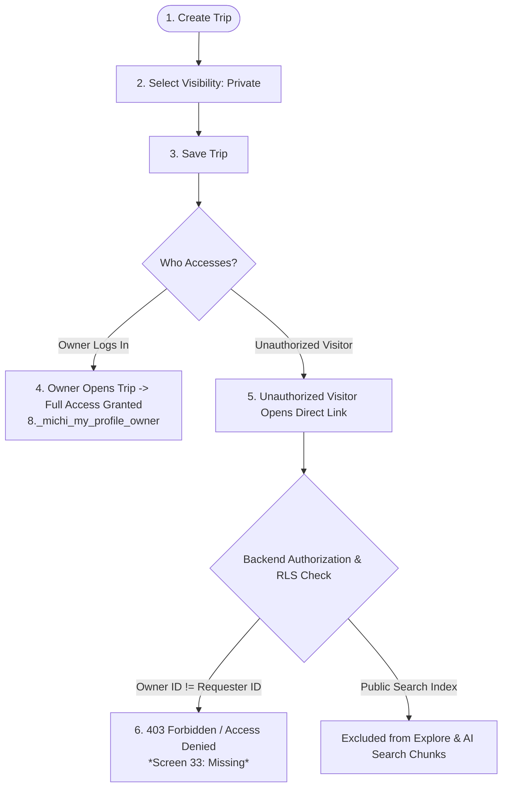

# Primary User Journeys & End-to-End User Flows
## Project: MICHI (道) — The Adventure Explorer Travel Social Platform

**Version:** 1.0  
**Status:** Approved Specification (Audited with Google Stitch Exports)  
**Date:** November 2026  
**Document Owner:** UI/UX & Product Engineering Team  
**Audit Reference:** [STITCH_DESIGN_AUDIT.md](STITCH_DESIGN_AUDIT.md)  

---

## 1. Overview of Primary User Journeys

In accordance with Section 8 of the PRD, MICHI is designed around five foundational user journeys:
- **User Journey A**: Registration and Profile Onboarding.
- **User Journey B**: Trip Creation, Stop Management, and Publishing.
- **User Journey C**: Explore and Discover Public Journeys.
- **User Journey D**: AI Traveller Discovery (Profile-Specific Chatbot).
- **User Journey E**: Private Trip Creation and Unauthorized Access Protection.

---

## 2. User Journey A — Registration

> *Landing page → Sign Up → Enter Details → Email Verification → Profile Setup → Home Feed.*



### Stitch Design Status for Journey A
- Step 1 (Landing Page): **Exported & Complete** ([michi_landing_page_desktop](file:///d:/travel%20social%20medio%20web/stitch_michi_travel_design_system/michi_landing_page_desktop)).
- Step 2 & 3 (Registration Form): **Exported & Complete** ([2._michi_registration](file:///d:/travel%20social%20medio%20web/stitch_michi_travel_design_system/2._michi_registration)).
- Step 4 (Email Verification): **Exported & Complete** ([4._michi_email_verification](file:///d:/travel%20social%20medio%20web/stitch_michi_travel_design_system/4._michi_email_verification)).
- Step 5 (Profile Setup Form): **Missing in Stitch export** (Requires design of username selection & avatar upload modal).
- Step 6 (Home Feed): **Exported & Complete** ([6._michi_home_feed](file:///d:/travel%20social%20medio%20web/stitch_michi_travel_design_system/6._michi_home_feed)).

---

## 3. User Journey B — Create Trip

> *Home Feed → Create Trip → Add Trip Details → Select Starting Location → Add Stops → Select Ending Location → Add Experiences → Upload Media → Save Draft → Preview → Publish.*

```mermaid
flowchart TD
    HOME([1. Home Feed<br/>6._michi_home_feed]) --> CREATE_BTN[2. Click 'Create Trip'<br/>*Trigger Present in Feed*]
    CREATE_BTN --> DETAILS[3. Add Trip Details: Title, Dates, Category<br/>*Screen 13: Missing*]
    DETAILS --> START_LOC[4. Select Starting Location via Google Places<br/>*Screen 14: Missing*]
    START_LOC --> ADD_STOPS[5. Add Intermediate Stops: Coordinates & Notes<br/>*Screen 15: Missing*]
    ADD_STOPS --> END_LOC[6. Select Ending Location]
    END_LOC --> ADD_EXP[7. Add Stop-wise Experiences<br/>*Screen 20: Missing*]
    ADD_EXP --> UPLOAD_MEDIA[8. Upload Photographs & Video Clips<br/>*Screen 21: Missing*]
    UPLOAD_MEDIA --> SAVE_DRAFT[9. Save as Draft]
    SAVE_DRAFT --> PREVIEW[10. Preview Route Map & Timeline<br/>*Screen 19: Missing*]
    PREVIEW --> PUBLISH_CHOICE{Publish Trip?}
    PUBLISH_CHOICE -->|Keep Draft| DRAFT_SAVED([11a. Saved in User Dashboard<br/>8._michi_my_profile_owner])
    PUBLISH_CHOICE -->|Publish| PUBLISH_EXEC[11b. Publish Trip (Public or Private)<br/>*Screen 18: Missing*]
    PUBLISH_EXEC --> TRIP_LIVE([12. Trip Published & Viewable])
```

### Stitch Design Status for Journey B
- **CRITICAL GAP**: The entire Trip Creation flow (Screens 13, 14, 15, 16, 18, 19, 20, 21) is **missing from the current Stitch export**.
- The trigger button exists in `6._michi_home_feed`, and draft resumes are visible on `8._michi_my_profile_owner`, but the interactive creation screens must be designed in Google Stitch before Phase 3 development begins.

---

## 4. User Journey C — Explore Trips

> *Explore → Search Destination → Select Trip → View Route Map → Explore Stops → View Photos → Read Blog → Watch Vlog → Follow Traveller.*



### Stitch Design Status for Journey C
- Step 1 & 2 (Explore & Search): **Exported & Complete** ([5._michi_explore](file:///d:/travel%20social%20medio%20web/stitch_michi_travel_design_system/5._michi_explore)).
- Step 3 (Trip Cards): **Exported & Complete** inside `5._michi_explore`.
- Step 4 (Public Trip Details Screen 3): **Missing in Stitch export**.
- Step 5 (Blog Reading Screen 5): **Missing in Stitch export**.
- Step 8 (Follow & Profile Interaction): **Exported & Complete** ([7._michi_public_traveller_profile](file:///d:/travel%20social%20medio%20web/stitch_michi_travel_design_system/7._michi_public_traveller_profile)).

---

## 5. User Journey D — AI Traveller Discovery

> *Explore → Open Traveller Profile → Ask AI → Ask Question → Receive Answer → View Source Trip → Explore Complete Journey.*



### Stitch Design Status for Journey D
- **100% EXPORTED & COMPLETE**:
  - Explore Page: [5._michi_explore/code.html](file:///d:/travel%20social%20medio%20web/stitch_michi_travel_design_system/5._michi_explore/code.html).
  - Public Profile with "Ask AI" trigger: [7._michi_public_traveller_profile/code.html](file:///d:/travel%20social%20medio%20web/stitch_michi_travel_design_system/7._michi_public_traveller_profile/code.html).
  - Interactive AI Chatbot with source citations and suggested question pills: [9._michi_ask_ai_about_this_traveller/code.html](file:///d:/travel%20social%20medio%20web/stitch_michi_travel_design_system/9._michi_ask_ai_about_this_traveller/code.html).

---

## 6. User Journey E — Private Trip Protection

> *Create Trip → Select Private → Save → Owner Opens Trip → Unauthorized Visitor Attempts Access → Access Denied.*



### Stitch Design Status for Journey E
- Owner View: [8._michi_my_profile_owner](file:///d:/travel%20social%20medio%20web/stitch_michi_travel_design_system/8._michi_my_profile_owner) displays drafts and private trips.
- Unauthorized Access (Screen 33 / 403 Forbidden): **Missing in Stitch export** (Requires design of friendly error screen).

---

## 7. Cross-Reference Links

- Stitch Design Audit: [STITCH_DESIGN_AUDIT.md](STITCH_DESIGN_AUDIT.md)
- UI/UX Guidelines: [UI_UX_GUIDELINES.md](UI_UX_GUIDELINES.md)
- Design System: [DESIGN_SYSTEM.md](DESIGN_SYSTEM.md)
- Product Requirements Document: [PRD.md](PRD.md)
